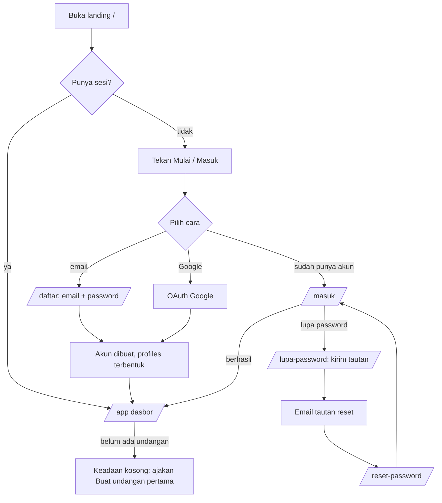
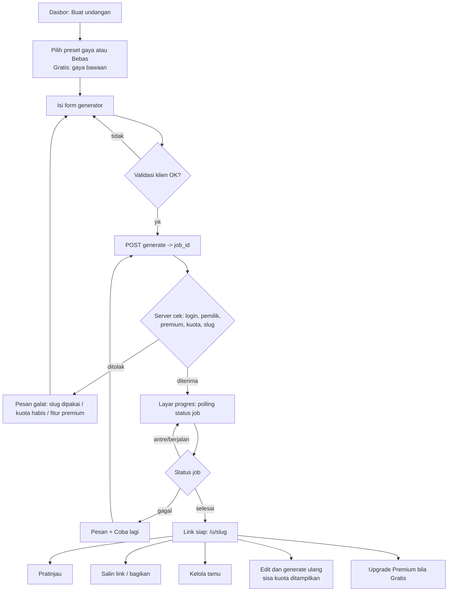
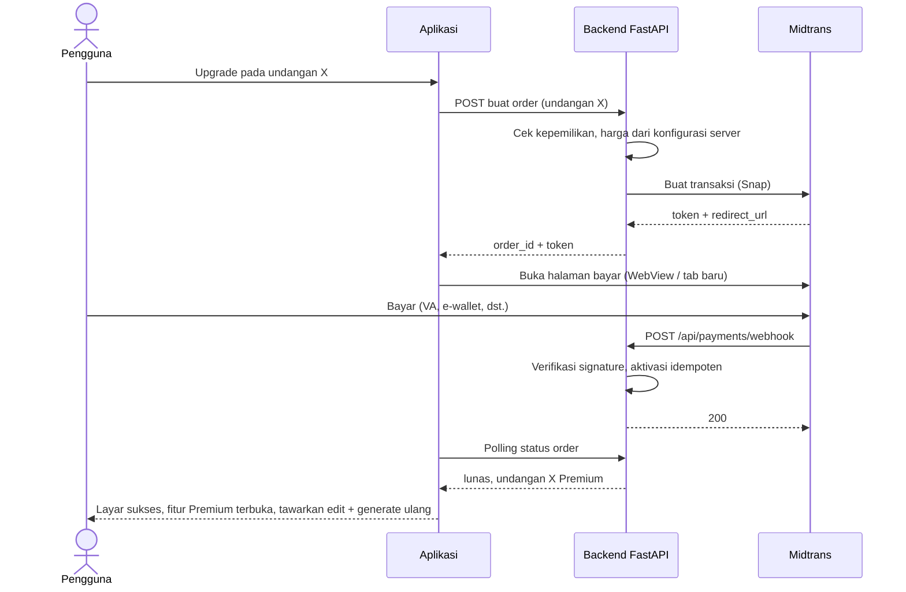
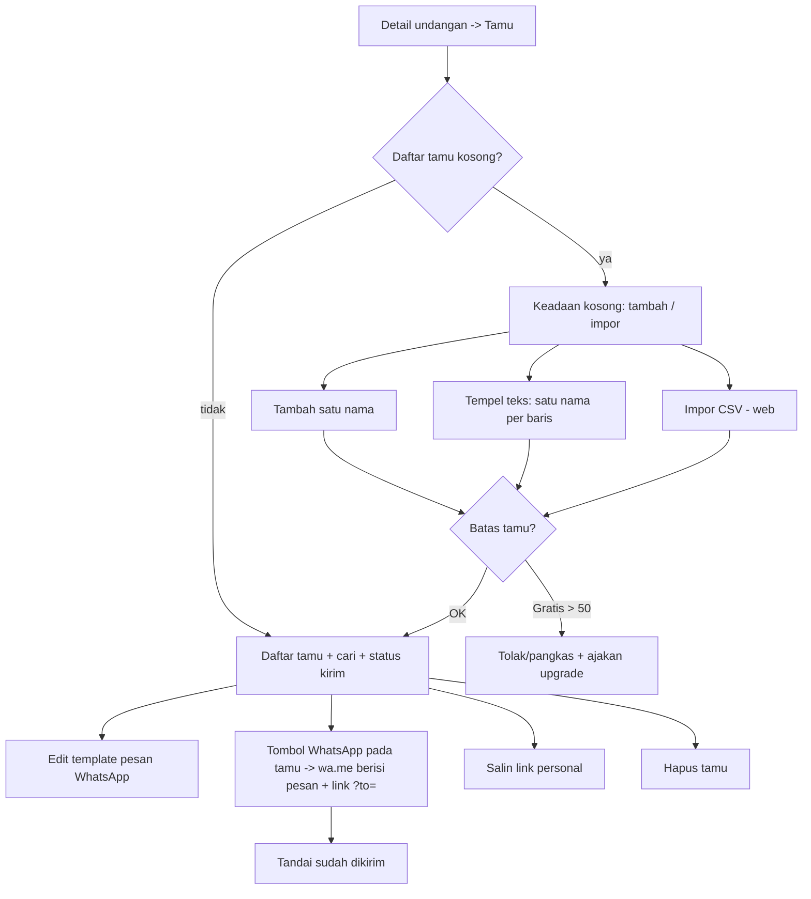
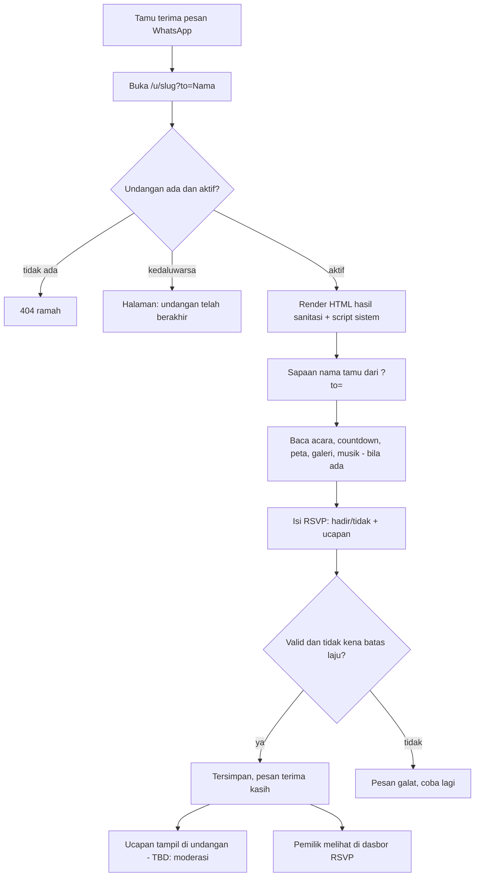

# 02 · User Flow dan Daftar Layar CartaAI v2

Status: draf F0. Pelengkap [01-prd.md](01-prd.md); sumber keputusan [00-keputusan-dan-analisis.md](00-keputusan-dan-analisis.md).
Route di bawah adalah **usulan** untuk Expo Router (satu codebase web + mobile). Nama final dan struktur
folder mengikuti dokumen arsitektur (`docs/04`-`docs/08`) bila berbeda. Hal belum diputuskan ditandai **TBD**.

## 1. Peta navigasi

Kondisi sekarang (mobile/app): `index`, `login`, `register`, `forgot-password`, `update-password`,
`payment`, `midtrans-payment`, `payment-status`, `success`, `chat`, `template-usage/[id]`, dan tab
`index|generator|template|history|harga|about|profile`. Di v2 ini ditata ulang menjadi grup rute.

### Route yang diusulkan

| Route | Akses | Layar | Keterangan |
|-------|-------|-------|------------|
| `/` | Publik | Landing | Static rendering (SEO). Pengguna yang sudah login tetap melihat landing, dengan tombol "Buka dasbor" |
| `/harga` | Publik | Harga | Tabel Gratis vs Premium (Q17) |
| `/gaya` | Publik | Galeri preset gaya | Preview preset (Q18) |
| `/masuk` | Publik (tamu saja) | Login | Redirect ke `/app` bila sudah login |
| `/daftar` | Publik (tamu saja) | Daftar | |
| `/lupa-password` | Publik | Lupa password | |
| `/auth/callback` | Publik | Penangkap OAuth Google / tautan email | Tanpa UI selain loading |
| `/reset-password` | Sesi pemulihan | Set password baru | Dari tautan email |
| `/u/[slug]` | Publik | Halaman undangan (HTML hasil AI) | **Bukan layar Expo**: disajikan backend lewat Vercel rewrite (Q19, Q14), origin terpisah; `?to=` nama tamu |
| `/app` | Terproteksi | Beranda/dasbor (ringkasan undangan) | Folder `mobile/app/app/` (bukan grup, agar URL berawalan `/app`); redirect ke `/masuk` bila tanpa sesi |
| `/app/undangan` | Terproteksi | Riwayat undangan | |
| `/app/undangan/baru` | Terproteksi | Generator (form) | Pilih preset lalu isi form |
| `/app/undangan/[id]` | Terproteksi | Detail undangan | Ringkasan, link, status, aksi |
| `/app/undangan/[id]/edit` | Terproteksi | Edit data + generate ulang | Form yang sama dengan generator, terisi |
| `/app/undangan/[id]/proses/[jobId]` | Terproteksi | Progres generate | Polling status job |
| `/app/undangan/[id]/tamu` | Terproteksi | Kelola tamu + WhatsApp + impor | |
| `/app/undangan/[id]/rsvp` | Terproteksi | Dasbor RSVP dan ucapan | |
| `/app/undangan/[id]/versi` | Terproteksi | Versi (terakhir + 1 sebelumnya) dan rollback | Bisa berupa modal dari detail |
| `/app/undangan/[id]/upgrade` | Terproteksi | Ringkasan pesanan + bayar | |
| `/app/pembayaran/[orderId]` | Terproteksi | Status pembayaran | Dituju setelah Midtrans |
| `/app/bantuan` | Terproteksi | Chatbot | Batas 20 pesan/hari |
| `/app/akun` | Terproteksi | Profil, tema (terang/gelap/sistem), keluar | |
| `+not-found` | Publik | 404 | |

Dibuang dari versi sekarang: tab `about` (dipindah ke landing), `template-usage/[id]` (diganti galeri
preset + generator), `midtrans-payment`/`payment`/`success` terpisah (digabung ke `upgrade` dan
`pembayaran/[orderId]`), `BlockchainPayment` (Q8).

### Navigasi per ukuran layar
- **Mobile**: tab bawah 4 item: Beranda, Undangan, Bantuan, Akun. Tombol utama "Buat undangan" menonjol di Beranda/Undangan.
- **Desktop (>= 1024 px, TBD breakpoint final dengan design system)**: sidebar kiri (item yang sama) + konten maks lebar ~1100 px.
- Header landing: logo, Gaya, Harga, Masuk, tombol Mulai; di mobile menjadi menu ringkas.

## 2. Alur utama

### 2.1 Onboarding dan auth

### 2.2 Buat undangan → progres → link siap → bagikan

### 2.3 Upgrade Premium → bayar → aktif

Bila pengguna menutup halaman bayar lebih awal: layar `pembayaran/[orderId]` menampilkan status
terkini dari server (pending → tombol "Lanjutkan pembayaran" jika token masih berlaku; TBD masa berlaku).

### 2.4 Kelola tamu dan kirim WhatsApp

### 2.5 Tamu membuka undangan dan RSVP

## 3. Form generator: rincian field

Sumber: `InvitationRequest` di `backend/routers/invitations.py` dan `mobile/src/screens/GeneratorScreen.tsx`.
Di v2 skema kolom/DB mengikuti dokumen arsitektur; nama field API di bawah mengikuti nama sekarang
sebagai acuan, nama final **TBD** (bisa diganti ke bahasa Inggris/snake_case oleh sesi arsitektur).
Pembatasan Premium harus ditegakkan **di server** juga (B1), tidak hanya dikunci di UI.

### Data inti

| Field (acuan) | Label | Wajib? | Paket | Catatan |
|---------------|-------|--------|-------|---------|
| `slug` | Alamat link | **Wajib** | Gratis | Backend mewajibkan; UI sekarang membuatnya otomatis. v2: disarankan dari nama mempelai, bisa diubah, cek ketersediaan, `a-z0-9-`, tetap saat generate ulang |
| `namaMempelaiPria` | Nama mempelai pria | **Wajib** | Gratis | |
| `namaAyahMempelaiPria` | Nama ayah mempelai pria | Opsional | Gratis | |
| `namaIbuMempelaiPria` | Nama ibu mempelai pria | Opsional | Gratis | |
| `namaMempelaiWanita` | Nama mempelai wanita | **Wajib** | Gratis | |
| `namaAyahMempelaiWanita` | Nama ayah mempelai wanita | Opsional | Gratis | |
| `namaIbuMempelaiWanita` | Nama ibu mempelai wanita | Opsional | Gratis | |
| `tanggalAcara` | Tanggal acara | **Wajib** | Gratis | Date picker; UI sekarang default hari ini, v2 wajib dipilih dan tidak boleh di masa lalu (TBD aturan) |
| `waktuAcara` | Waktu acara (akad/pemberkatan) | Opsional | Gratis | Server mengambil HH:MM dan membuang "WIB/WITA" (`sanitize_time`); v2 sebaiknya pemilih jam + zona waktu (TBD) |
| `lokasiAcara` | Lokasi acara | **Wajib** | Gratis | Teks alamat; peta/koordinat: TBD |
| `waktuResepsi` | Waktu resepsi | Opsional | Gratis | |
| `tempatResepsi` | Tempat resepsi | Opsional | Gratis | |
| `agama` | Agama | Opsional | Gratis | Pilihan: islam, kristen, hindu, buddha, lainnya; mempengaruhi salam/teks pembuka. Katolik dan konghucu belum ada di opsi sekarang: TBD ditambah |
| `catatanKhusus` | Catatan khusus | Opsional | Gratis | Teks bebas ke AI (di-escape, Q14). Batas panjang TBD |

### Gaya dan tampilan (semua paket, Q27)

| Field (acuan) | Label | Wajib? | Paket | Catatan |
|---------------|-------|--------|-------|---------|
| (baru) `presetId` | Preset gaya / "Bebas" | Opsional | Gratis | Q18, Q27; menggantikan layar Template sekarang |
| `temaWarna` | Tema warna | Opsional | Gratis (Q27) | Sekarang: soft-pink, sage-green, navy-gold, terracotta, monochrome. Pada mode "Bebas" boleh teks bebas dari pengguna (Q18) |
| `jenisUndangan` | Jenis/gaya undangan | Opsional | **Premium** | Sekarang: klasik, modern, rustic, minimalis, luxury, vintage. Kemungkinan melebur dengan preset (TBD) |
| (baru) `design_notes` | Ceritakan desain impianmu | Opsional | Gratis | Q27; ≤ 300, diikuti AI hanya untuk tampilan |
| `customFont` | Font kustom | - | - | Ada di backend, **tidak ada di UI** sekarang. v2: dihapus; font ditentukan preset/AI (TBD konfirmasi) |

### Media dan fitur tambahan (Premium)

| Field (acuan) | Label | Wajib? | Paket | Catatan |
|---------------|-------|--------|-------|---------|
| `fotoCover` | Foto cover prewedding | Opsional | **Premium** | Ada di UI, **tidak ada di `InvitationRequest`** (dikirim sebagai bagian lain/hilang); v2 dijadikan field resmi |
| `fotoMempelaiPria` | Foto mempelai pria | Opsional | **Premium** | Unggah gambar |
| `fotoMempelaiWanita` | Foto mempelai wanita | Opsional | **Premium** | Unggah gambar |
| `galeriFoto[]` | Galeri foto | Opsional | **Premium** | Maks 10 (Q17); batas ukuran per berkas TBD |
| `musik` | Musik latar | Opsional | **Premium** | Unggah audio (batas ukuran/durasi TBD); autoplay hanya setelah interaksi |
| `hadiah[]` | Amplop digital | Opsional | **Premium** | Daftar rekening, tiap item: |
| ↳ `namaBank` | Nama bank / e-wallet | Wajib bila item ada | Premium | Pilihan: BCA, BNI, BRI, Mandiri, GoPay, OVO, Dana, Lainnya |
| ↳ `noRekening` | Nomor rekening / HP | Wajib bila item ada | Premium | |
| ↳ `namaRekening` | Atas nama | Wajib bila item ada | Premium | Batas jumlah item: TBD |

### Yang ditambahkan sistem (bukan input pengguna)
Watermark (Gratis), slot RSVP/countdown/musik/`guest-name`/`gift` (Q13), masa aktif 30 hari/1 tahun,
penghitung kuota generate ulang (Gratis 3x, Premium 15x).

### Aturan form
- Kolom Premium pada undangan Gratis tetap terlihat tetapi terkunci (ikon kunci, ajakan upgrade); server menolak bila dikirim.
- Draf form disimpan lokal agar tidak hilang saat tutup app (S, TBD).
- Setelah upgrade, form edit membuka kolom Premium dan menawarkan generate ulang.

## 4. Daftar layar

Notasi state: **Kosong / Memuat / Galat / Sukses**. Mobile vs desktop dijelaskan per layar.

### 4.1 Landing `/`
- **Tujuan**: menjelaskan produk, mengarahkan ke daftar. Statis untuk SEO.
- **Isi**: hero (judul serif, subjudul, CTA Mulai Gratis), cara kerja 3 langkah, galeri preset, fitur (tamu, RSVP, WhatsApp), ringkasan harga, FAQ, footer.
- **State**: tanpa data dinamis. Bila sudah login, CTA menjadi "Buka dasbor". Galat: tidak ada (statis).
- **Mobile**: satu kolom, header ringkas, CTA tetap di bawah (sticky, TBD). **Desktop**: hero dua kolom (teks + mockup undangan), galeri 3-4 kolom.

### 4.2 Harga `/harga`
- **Tujuan**: membandingkan Gratis vs Premium (tabel Q17), Rp99.000 sekali bayar per undangan.
- **Isi**: dua kartu paket, tabel fitur, FAQ pembayaran, CTA.
- **State**: statis; harga dibaca dari konfigurasi publik (TBD) atau konstanta build.
- **Mobile**: kartu bertumpuk, tabel dapat di-scroll atau diganti daftar. **Desktop**: dua kartu berdampingan + tabel penuh.

### 4.3 Galeri gaya `/gaya`
- **Tujuan**: memperlihatkan preset (Q18).
- **Isi**: grid kartu (gambar preview, nama, mood/palet), tombol "Pakai gaya ini" (→ login bila perlu → generator dengan preset terpilih).
- **State**: Memuat (skeleton), Kosong (tidak mungkin, preset dari konfigurasi), Galat (gambar gagal: placeholder).
- **Mobile**: grid 2 kolom. **Desktop**: grid 3-4 kolom + penyaring mood.

### 4.4 Masuk `/masuk`, Daftar `/daftar`, Lupa password, Reset password
- **Tujuan**: autentikasi (Q21).
- **Isi**: form email+password, tombol Google, tautan antar layar; daftar: konfirmasi password dan persetujuan ketentuan (TBD teks); lupa: field email; reset: password baru + konfirmasi.
- **State**: Memuat (tombol disabled + spinner); Galat (kredensial salah, email sudah dipakai, jaringan, tautan kedaluwarsa); Sukses (masuk → `/app`; lupa → "tautan terkirim"; reset → ke `/masuk`). Daftar mungkin butuh konfirmasi email (TBD sesuai pengaturan Supabase).
- **Mobile**: form penuh layar. **Desktop**: kartu form di tengah dengan panel ilustrasi di sisi.

### 4.5 Dasbor `/app`
- **Tujuan**: titik awal; ringkasan dan jalan pintas.
- **Isi**: sapaan, tombol "Buat undangan", daftar undangan terbaru (kartu: nama pasangan, tanggal, status, paket), ringkasan RSVP undangan aktif, kuota chatbot tersisa (S).
- **State**: Kosong (ilustrasi + "Buat undangan pertama"), Memuat (skeleton), Galat (coba lagi), Sukses.
- **Mobile**: kartu bertumpuk, tab bawah. **Desktop**: sidebar + grid kartu dan panel ringkasan di kanan.

### 4.6 Riwayat undangan `/app/undangan`
- **Tujuan**: semua undangan milik pengguna.
- **Isi**: daftar/grid kartu dengan status (draf, diproses, aktif, kedaluwarsa), badge Gratis/Premium, sisa masa aktif, menu aksi (buka, salin link, tamu, RSVP, edit, upgrade, hapus dengan konfirmasi).
- **State**: Kosong, Memuat, Galat, Sukses; setelah hapus: toast.
- **Mobile**: daftar kartu, aksi dalam sheet. **Desktop**: tabel dengan kolom + aksi inline.

### 4.7 Generator `/app/undangan/baru`
- **Tujuan**: mengumpulkan data dan memulai job generate.
- **Isi**: langkah 1 pilih preset/"Bebas", tema warna, dan keinginan desain (semua paket, Q27) lalu form bertahap dengan bagian: Mempelai, Orang tua, Acara, Gaya, Media, Amplop digital, Catatan; kolom Premium terkunci pada Gratis; panel ringkasan paket dan kuota; tombol "Buat undangan".
- **State**: Kosong (form awal); Memuat (unggah berkas berprogres, tombol disabled saat submit); Galat (validasi per field, slug dipakai, unggahan gagal, jaringan, fitur Premium ditolak); Sukses (→ layar progres).
- **Mobile**: stepper satu bagian per layar (menggantikan layar tunggal 1.522 baris), bilah progres langkah, tombol Lanjut tetap di bawah. **Desktop**: form dua kolom + pratinjau gaya/ringkasan di kanan, semua bagian terlihat sebagai halaman bergulir.

### 4.8 Progres generate `/app/undangan/[id]/proses/[jobId]`
- **Tujuan**: menunggu job async (Q15) dan transparan soal statusnya.
- **Isi**: indikator berlangkah (antre → menyusun desain → menyisipkan RSVP/countdown → selesai), teks sabar, tombol "Lanjutkan di latar" (kembali ke dasbor; job tetap berjalan).
- **State**: Memuat/antre/berjalan (polling interval TBD); Sukses (otomatis tampil link siap); Galat (job gagal + alasan ringkas + Coba lagi; timeout polling + "periksa nanti"); app ditutup lalu dibuka lagi: status dipulihkan dari server.
- **Mobile**: layar penuh terpusat. **Desktop**: kartu di tengah.

### 4.9 Link siap / Detail undangan `/app/undangan/[id]`
- **Tujuan**: pusat kendali satu undangan setelah jadi.
- **Isi**: link `/u/<slug>` dengan Salin/Bagikan, pratinjau (iframe di web; WebView di mobile), kartu status (paket, masa aktif, sisa generate ulang), tombol Edit & generate ulang, Versi/rollback, Tamu, RSVP, Upgrade (Gratis), Hapus.
- **State**: Memuat; Galat (undangan tak ditemukan/bukan milik: 404); Sukses; khusus: Diproses (job berjalan → tautan ke progres), Kedaluwarsa (banner + upgrade/perpanjang: TBD).
- **Mobile**: pratinjau di atas, aksi sebagai daftar. **Desktop**: pratinjau ponsel di kiri, panel aksi di kanan.

### 4.10 Edit dan generate ulang `/app/undangan/[id]/edit`
- **Tujuan**: mengubah data dan generate ulang (Q16).
- **Isi**: form generator terisi data tersimpan, slug terkunci (tampil saja), peringatan "sisa N dari 3/15 generate ulang", tombol Generate ulang.
- **State**: Kuota habis (tombol disabled, pesan + ajakan upgrade bila Gratis); selain itu sama dengan generator.
- **Mobile/Desktop**: sama dengan generator.

### 4.11 Versi `/app/undangan/[id]/versi`
- **Tujuan**: kembali ke versi sebelumnya.
- **Isi**: dua kartu (versi sekarang, versi sebelumnya) dengan pratinjau dan tanggal, tombol "Pulihkan versi ini" (konfirmasi). Apakah rollback memakai kuota: **TBD** (usulan: tidak).
- **State**: Kosong (belum ada versi sebelumnya), Memuat, Galat, Sukses.
- **Mobile**: modal penuh. **Desktop**: dua pratinjau berdampingan.

### 4.12 Kelola tamu `/app/undangan/[id]/tamu`
- **Tujuan**: kelola daftar tamu dan kirim undangan lewat WhatsApp (Q20).
- **Isi**: penghitung (mis. 12/50 untuk Gratis), pencarian, tambah satu tamu, tempel banyak nama, impor CSV (web), editor template pesan dengan pratinjau, daftar tamu (nama, status kirim, tombol WhatsApp, salin link, hapus), hapus massal.
- **State**: Kosong (ajakan tambah/impor), Memuat, Galat (batas tamu Gratis tercapai → ajakan upgrade; format CSV salah dengan ringkasan baris bermasalah; tamu duplikat), Sukses (toast ringkasan impor: N ditambah, M dilewati). Tanpa nomor telepon di data tamu sekarang: WhatsApp membuka pemilih kontak; nomor per tamu **TBD** (bila ditambah, kolom CSV bertambah).
- **Mobile**: daftar vertikal, aksi dalam sheet, impor teks tempel (CSV hanya web, Q20). **Desktop**: tabel dengan aksi inline, panel template pesan di samping, tombol impor CSV.

### 4.13 Dasbor RSVP `/app/undangan/[id]/rsvp`
- **Tujuan**: memantau kehadiran dan membaca ucapan.
- **Isi**: kartu hitungan (hadir, tidak hadir, belum menjawab dari daftar tamu), daftar respons (nama, kehadiran, ucapan, waktu), filter, ekspor CSV (S).
- **State**: Kosong ("belum ada respons" + tips bagikan), Memuat, Galat, Sukses.
- **Mobile**: kartu hitungan di atas, daftar bertumpuk. **Desktop**: kartu hitungan sebaris, tabel + panel ucapan.

### 4.14 Upgrade `/app/undangan/[id]/upgrade`
- **Tujuan**: membeli Premium untuk satu undangan (Q7).
- **Isi**: nama undangan, daftar yang terbuka (foto, galeri 10, musik, rekening, gaya, tanpa watermark, 1 tahun, tamu tak terbatas, 15x generate ulang), harga Rp99.000 (dari server), tombol Bayar, catatan: berlaku untuk undangan ini saja.
- **State**: Memuat (membuat order), Galat (gagal membuat order/Midtrans tidak tersedia), Sukses (→ halaman bayar Midtrans); sudah Premium: tampil keterangan, tombol disembunyikan.
- **Mobile**: layar penuh; pembayaran di WebView/tab peramban. **Desktop**: dua kolom ringkasan + pesanan; pembayaran di tab/popup (TBD).

### 4.15 Status pembayaran `/app/pembayaran/[orderId]`
- **Tujuan**: menampilkan hasil bayar dari server.
- **Isi**: status (menunggu, lunas, kedaluwarsa, gagal/dibatalkan), rincian order, aksi: Lanjutkan pembayaran (menunggu), Kembali ke undangan / Edit & generate ulang (lunas), Coba lagi (kedaluwarsa/gagal).
- **State**: Memuat (polling singkat setelah kembali dari Midtrans), Menunggu, Sukses, Galat. Lunas tetapi webhook belum diproses: tampil "sedang diverifikasi" dan polling (batas waktu TBD).
- **Mobile/Desktop**: kartu di tengah, sama.

### 4.16 Bantuan (chatbot) `/app/bantuan`
- **Tujuan**: menjawab pertanyaan penggunaan (Q9).
- **Isi**: daftar pesan, kolom input, penghitung "N dari 20 pesan hari ini", saran pertanyaan.
- **State**: Kosong (saran pertanyaan), Memuat (indikator mengetik), Galat (jaringan: kirim ulang; batas harian habis: input disabled + "coba lagi besok"; 401: arahkan masuk).
- **Mobile**: layar penuh; tombol FAB opsional di layar lain. **Desktop**: panel samping atau halaman biasa.

### 4.17 Akun `/app/akun`
- **Tujuan**: pengaturan dasar.
- **Isi**: email, nama tampilan, ganti password (hanya akun email), pilihan tema Terang/Gelap/Sistem, keluar, hapus akun (TBD apakah ada di v2).
- **State**: Memuat, Galat, Sukses (toast).
- **Mobile**: daftar setelan. **Desktop**: kartu di tengah dengan bagian bertab.

### 4.18 Halaman undangan publik `/u/[slug]`
- **Tujuan**: menampilkan undangan ke tamu (Q13, Q14, Q19).
- **Isi**: HTML hasil AI tersanitasi + script sistem (RSVP & ucapan, countdown, musik, nama tamu dari `?to=`, watermark untuk Gratis). Disajikan backend dari path/origin terpisah dengan CSP.
- **State**: Memuat (HTML ringan, tanpa spinner khusus), 404, Kedaluwarsa, Sukses; RSVP: mengirim/terkirim/galat/dibatasi laju. Tanpa `?to=`: sapaan umum ("Tamu undangan").
- **Mobile**: prioritas utama (mayoritas tamu dari WhatsApp), lebar 360 px. **Desktop**: tata letak mengikuti desain AI; disarankan dibatasi lebar kolom konten (diatur lewat brief desain).

### 4.19 404 dan galat umum
- **Isi**: pesan ramah, tombol ke beranda. Galat jaringan global: banner "tidak ada koneksi" dengan Coba lagi.

## 5. Keadaan lintas layar (konvensi)
- Memuat: skeleton untuk daftar, spinner pada tombol aksi; tidak ada layar kosong putih.
- Galat: pesan bahasa Indonesia yang menjelaskan tindakan berikutnya + tombol Coba lagi; kode galat teknis tidak ditampilkan.
- Kosong: ilustrasi/ikon sederhana, satu kalimat penjelasan, satu CTA.
- Sukses: toast singkat atau layar sukses bila alur selesai.
- Fitur Premium terkunci: ikon kunci + penjelasan + tautan ke upgrade; tidak disembunyikan.
- Dark mode berlaku untuk semua layar aplikasi, bukan untuk `/u/[slug]`.

## 6. TBD khusus dokumen ini
1. Nama route final (Indonesia vs Inggris) dan struktur folder Expo Router, selaras dengan dokumen arsitektur.
2. Breakpoint desktop final (menunggu `docs/03-design-system.md`).
3. Interval polling job dan batas waktu tunggu; perilaku job yang gagal terhadap kuota.
4. Slug otomatis vs diketik pengguna; batas panjang.
5. Nomor telepon per tamu untuk WhatsApp langsung; format kolom CSV.
6. Moderasi ucapan di halaman undangan.
7. Cara membuka Midtrans di mobile (WebView vs peramban) dan web (tab baru vs popup).
8. Zona waktu acara dan peta/koordinat lokasi.
9. Penghapusan akun, konfirmasi email saat daftar.
10. Perpanjangan undangan kedaluwarsa.
