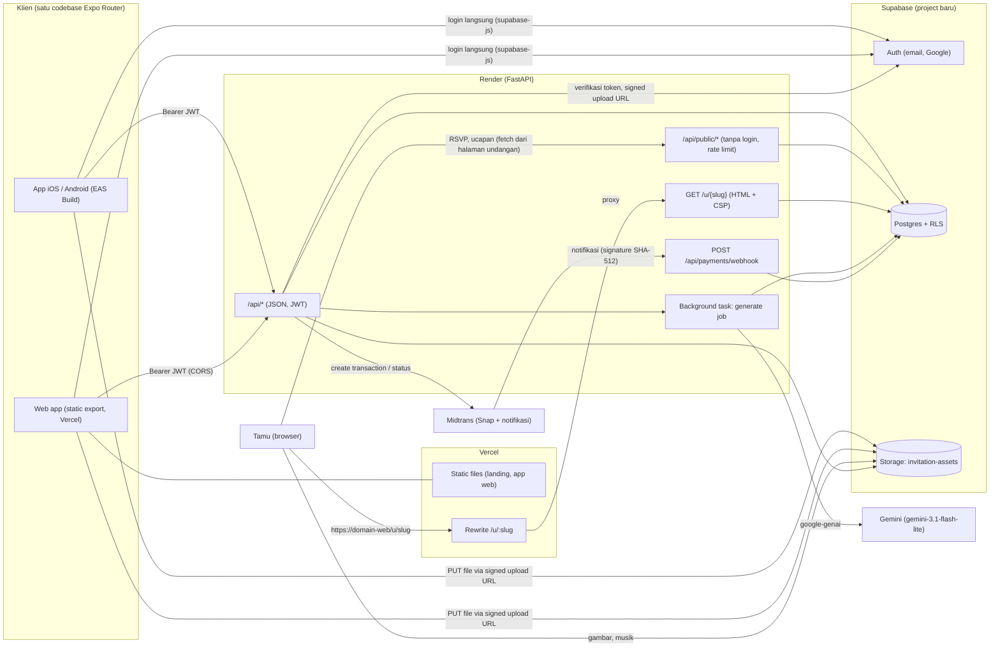
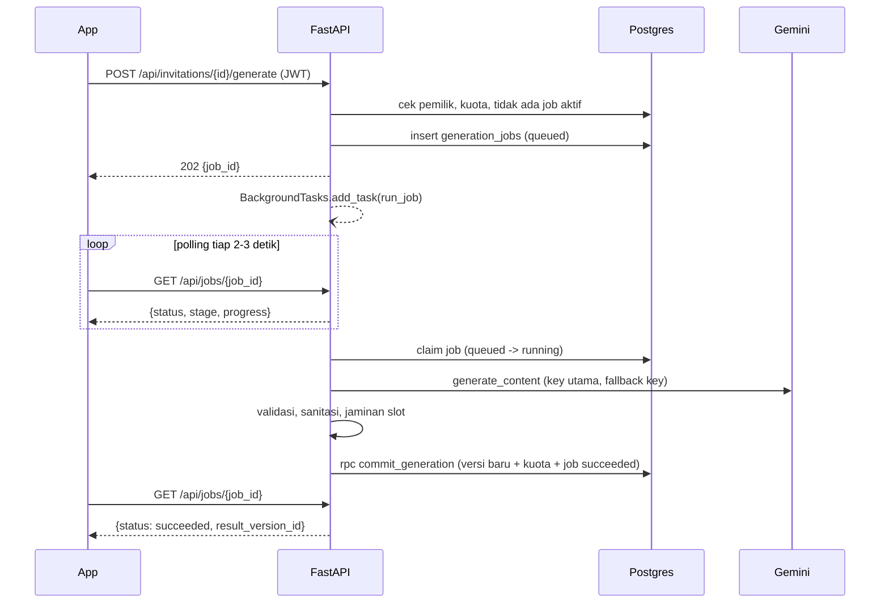
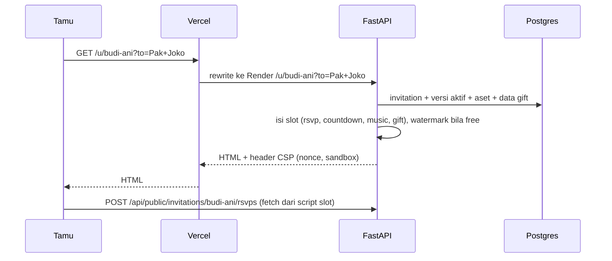
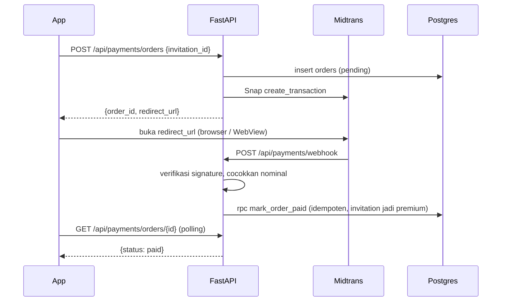

# 04 · Arsitektur (Refactor v2)

Turunan dari [00-keputusan-dan-analisis.md](00-keputusan-dan-analisis.md) (sumber kebenaran; kode Q.. merujuk ke sana).
Dokumen terkait: [05-skema-database.md](05-skema-database.md), [06-api-spec.md](06-api-spec.md),
[07-pipeline-generate-ai.md](07-pipeline-generate-ai.md), [08-rencana-refactor.md](08-rencana-refactor.md).
Disusun 2026-11-18 dari pembacaan seluruh `backend/` dan bagian auth/data/payment di `mobile/src`.

Penanda: **[Keputusan]** = diambil di dokumen ini (bukan dari Q1–Q25, perlu persetujuan pemilik bila keberatan),
**TBD** = belum diputuskan.

## 1. Diagram komponen



Peran tiap komponen:

| Komponen | Peran | Tidak boleh |
|----------|-------|-------------|
| Expo app (iOS/Android/web) | UI, login via Supabase Auth, memanggil FastAPI, upload langsung ke Storage lewat signed URL | Menentukan status premium/kuota; memegang service-role key; menulis tabel langsung |
| Vercel | Menyajikan static export web; rewrite `/u/:slug` → Render | Menjalankan logika bisnis |
| FastAPI (Render) | Satu-satunya penulis data bisnis; verifikasi JWT; cek kepemilikan, premium, kuota; job generate; webhook; menyajikan undangan | Menampilkan stack trace / rahasia ke klien |
| Supabase | Auth, Postgres (RLS aktif), Storage | — |
| Gemini | Membuat HTML undangan (dan jawaban chatbot) | Dipanggil dari klien |
| Midtrans | Pembayaran Snap (redirect_url), notifikasi ke satu webhook | — |

### Alur 1 · Generate undangan (async)



### Alur 2 · Tamu membuka undangan



### Alur 3 · Bayar premium (satu undangan)



## 2. Struktur folder target

### 2.1 Backend (`backend/`)

Aturan lapisan: **router tipis** (parse request, panggil satu fungsi service, bentuk response) → **service**
(aturan bisnis: kepemilikan, plan, kuota, orkestrasi) → **repo** (satu modul per agregat, hanya query ke
Supabase). Client Supabase **tunggal**, service-role, dibuat sekali di `db.py`. Tidak ada `print`; pakai `logging`.

```
backend/
  app/
    main.py              # create_app(): router, middleware (CORS, request-id), exception handler, lifespan
    config.py            # Settings (pydantic-settings) dari env; satu-satunya pembaca os.environ
    logging_config.py    # dictConfig; format baku; tidak mencatat token/HTML/body webhook mentah
    errors.py            # AppError(code, status, message, details) + handler -> format error seragam
    db.py                # get_supabase(): client service-role tunggal (lru_cache)
    deps.py              # get_current_user (verifikasi JWT), get_settings, rate_limit
    schemas/             # model Pydantic request/response (invitation, guest, rsvp, job, payment, chat, common)
    routers/             # tipis: health, me, presets, invitations, assets, jobs, guests, rsvps,
                         #        public, serve, payments, chat
    services/
      plans.py           # aturan free/premium (kuota, fitur, masa aktif) - satu tempat
      invitations.py     # CRUD, rollback, hapus (+ bersihkan Storage)
      assets.py          # upload-url, confirm, hapus
      generation.py      # buat job, run_job, recover_stale_jobs
      guests.py, rsvps.py, payments.py, chat.py
      ai/
        gemini.py        # klien google-genai, fallback key, retry
        prompt.py        # prompt sistem + builder (data + brief preset)
        sanitize.py      # whitelist tag/atribut, buang script/on*, filter CDN
        slots.py         # jamin & isi slot data-carta; watermark; CSP builder
        runtime.js       # script slot (rsvp, countdown, music, guest-name, gift, open)
    repos/               # invitations.py, versions.py, assets.py, guests.py, rsvps.py,
                         # orders.py, jobs.py, profiles.py, presets.py, chat_usage.py
  tests/                 # pytest (lihat 08, tugas F1-12)
  requirements.txt       # dependensi runtime
  requirements-dev.txt   # pytest, httpx, respx
  .env.example           # nama variabel saja, tanpa nilai
  .python-version        # TBD versi (usulan 3.12)
```

Perintah jalan: `uvicorn app.main:app --host 0.0.0.0 --port $PORT` (Render, root directory `backend`).
Perubahan dependensi: hapus `google-generativeai`; tambah `google-genai`, `pydantic-settings`, `beautifulsoup4`,
`html5lib` (sanitizer), dev: `pytest`, `respx`. `supabase` dan `midtransclient` dipertahankan.
`supabase-py` bersifat sinkron → endpoint ditulis `def` (threadpool FastAPI); job memakai fungsi sinkron
di `BackgroundTasks` (juga threadpool). **[Keputusan]** tidak memakai async client agar kode sederhana.

### 2.2 Frontend (`mobile/`)

```
mobile/
  app/                         # HANYA route Expo Router (file tipis, merender screen dari features)
    _layout.tsx                # provider: Theme, QueryClient, Auth; guard rute
    index.tsx                  # landing (static rendering untuk SEO)
    (auth)/                    # masuk, daftar, lupa-password, reset-password, auth/callback
    (marketing)/               # harga, gaya (preset)
    app/                       # area login (guard di app/_layout.tsx), URL /app/...:
                               #   index, undangan/{index,baru}, undangan/[id]/{index,edit,
                               #   proses/[jobId],tamu,rsvp,versi,upgrade}, pembayaran/[orderId],
                               #   bantuan, akun
    # Daftar route kanonik: docs/02-user-flow-dan-layar.md §1. Callback Midtrans → /app/pembayaran/[orderId]
  src/
    features/<fitur>/          # auth, invitations, generator, guests, rsvp, payments, chat, presets
      components/              #   komponen khusus fitur
      screens/                 #   screen (dipanggil route)
      hooks.ts, api.ts         #   hook TanStack Query + pemanggil endpoint fitur
    components/ui/             # komponen dasar design system (Button, Text, Input, Card, Sheet, Toast, ...)
    theme/                     # tokens (warna light/dark, tipografi, spacing, radius), ThemeProvider
    lib/
      api.ts                   # klien terketik: request<T>(), menempel JWT, menormalkan error
      api-schema.d.ts          # tipe hasil `openapi-typescript` dari /openapi.json backend
      supabase.ts              # client Supabase (anon key; storage web vs native)
      env.ts                   # membaca & memvalidasi EXPO_PUBLIC_*
    types/                     # tipe domain bersama (bila tidak dari api-schema)
```

**[Keputusan]** frontend: (a) tipe API di-generate dari OpenAPI FastAPI (`npm run gen:api`, devDependency
`openapi-typescript`) agar kontrak 06 tidak melenceng; (b) data fetching dengan **TanStack Query** (polling
job/order, cache, retry saat Render bangun) — satu dependensi baru dengan alasan jelas; (c) tidak ada akses
`supabase.from(...)` ke tabel dari klien — klien hanya memakai `supabase.auth` dan upload Storage via signed URL.

## 3. Keputusan auth

1. **Frontend memakai Supabase Auth langsung** (supabase-js): email+password, Google OAuth, lupa/ubah password
   (Q21). Endpoint `/auth/register` dan `/auth/login` di backend lama **dihapus** (backend tidak lagi
   memegang kredensial pengguna).
2. **Sesi**: native → `AsyncStorage`; web → `localStorage` (default supabase-js). Di web `detectSessionInUrl: true`
   (callback OAuth); di native `false` dan callback lewat deep link `cartaai://auth/callback`
   (`expo-web-browser`). Redirect URL kedua platform didaftarkan di dashboard Supabase.
3. **Backend memverifikasi JWT** di dependency `get_current_user`: header `Authorization: Bearer <access_token>`
   → `supabase.auth.get_user(token)` (satu panggilan jaringan ke Supabase Auth, cache memori 30 detik per token)
   → `AuthUser(id, email)`. **[Keputusan]** memakai `get_user` karena benar untuk skema penandatanganan JWT
   apa pun; jalur upgrade bila latensi mengganggu: verifikasi lokal via JWKS (`PyJWT`) — TBD, tidak untuk v2 awal.
   Catatan: client service-role tidak boleh dipakai memanggil `sign_in_*` (mengubah state client).
4. **Status premium dan kuota hanya ditentukan server.** Premium adalah atribut **undangan**
   (`invitations.plan`, Q7 bayar per undangan), bukan atribut user. Klien hanya membaca nilainya dari respons API
   dan tidak punya hak tulis ke `invitations`, `orders`, `generation_jobs` (RLS + revoke, lihat 05). Semua pengecekan
   (fitur premium, batas generate, batas tamu, jumlah foto) ada di `services/plans.py` dan dipanggil dari service.
5. **Kepemilikan**: setiap query data milik user memakai `owner_id = user.id` di repo; objek milik orang lain
   dibalas `404 not_found` (bukan 403) agar ID tidak bisa dienumerasi. Memperbaiki B2 dan B3.
6. **Endpoint publik** (`/u/{slug}`, `/api/public/*`, `/api/presets`, `/api/payments/webhook`) tanpa JWT; masing-masing
   punya perlindungan sendiri (rate limit, signature) — lihat 06.
7. Service-role key hanya di env Render. Anon key (publik) di bundle klien.

## 4. Job async

**Mekanisme** (Q15): `POST /api/invitations/{id}/generate` menyisipkan baris `generation_jobs` (`queued`),
membalas `202 {job_id}`, lalu `BackgroundTasks` menjalankan `run_job(job_id)`. Klien polling
`GET /api/jobs/{job_id}`. Status dan tahap tersimpan di Postgres, **bukan di memori proses**, sehingga
dapat dipulihkan. Tahap dan alur rinci di [07](07-pipeline-generate-ai.md).

Aturan keandalan:
- **Satu job aktif per undangan** (indeks unik parsial `status in ('queued','running')`) → mencegah balapan kuota.
- **Klaim atomik**: `update ... set status='running' where id=? and status='queued'`; jika 0 baris, abaikan.
- **Kuota dipakai hanya saat sukses**, dalam satu transaksi di RPC `commit_generation` (versi baru, penunjuk
  versi, `generations_used`, status job). Job gagal tidak memakan kuota.
- **Heartbeat**: `heartbeat_at` diperbarui tiap tahap dan tiap percobaan Gemini.
- **Pemulihan** `recover_stale_jobs()`: dijalankan saat startup (lifespan) dan setiap kali ada polling job. Job
  `queued`/`running` dengan `heartbeat_at` lebih tua dari `JOB_STALE_AFTER_SECONDS` (default 120 dtk; batas
  Gemini per panggilan 90 dtk) → diantrikan ulang (`attempt+1`, maks 2), lewat itu `failed` dengan
  `error_code='worker_lost'`. Pengguna dapat mencoba lagi tanpa kehilangan kuota.
- Bersih-bersih saat startup: aset `pending` > 24 jam dihapus.
- Konkurensi proses dibatasi `Semaphore(2)` agar RAM 512 MB tidak habis dan kuota Gemini terjaga.

**Batasan di Render free** (sesuai dokumentasi Render saat dokumen ini ditulis; **verifikasi ulang di F4**):
- Instance tidur setelah ±15 menit tanpa trafik; bangun ±30–60 detik. Request pertama lambat/timeout.
- Satu instance, RAM 512 MB, disk sementara; proses direstart saat deploy → task latar yang sedang jalan hilang.
- 750 jam instance/bulan per workspace: satu layanan 24/7 masih muat; lebih dari satu layanan free tidak.

Mitigasi:
1. Job tersimpan di DB + `recover_stale_jobs` (di atas): restart/tidur tidak membuat job menggantung selamanya.
2. Polling dari klien sendiri menjaga instance tetap bangun selama job berjalan.
3. Klien: timeout 60 dtk + retry dengan backoff untuk request pertama, UI "server sedang bangun"; pemanggilan
   `GET /healthz` saat app/generator dibuka untuk membangunkan lebih awal.
4. Ping eksternal `GET /healthz` tiap ±10 menit (cron-job.org / UptimeRobot, gratis) agar tidak tidur. Muat
   dalam 750 jam/bulan (744 jam).
5. Halaman undangan untuk tamu: header `Cache-Control: public, s-maxage=300, stale-while-revalidate=86400`
   agar CDN Vercel dapat menyajikan salinan saat Render tidur. **TBD verifikasi** bahwa Vercel meng-cache respons
   rewrite eksternal dengan nonce CSP yang ikut tersimpan (nonce dan HTML konsisten dalam satu respons cache).
6. Naik ke instance berbayar (Starter) bila trafik nyata — **TBD**, keputusan bisnis.
7. Supabase free dapat di-pause bila tidak aktif (±7 hari) — `GET /healthz?deep=1` (query ringan ke DB) ikut dipanggil
   oleh ping eksternal. **TBD verifikasi** kebijakan terbaru Supabase.

Bila skala tumbuh: ganti `BackgroundTasks` dengan worker terpisah (mis. Render background worker + antrian dari
tabel yang sama via `select ... for update skip locked`) tanpa mengubah skema/API.

## 5. Penyajian undangan dan keamanan (ringkas)

- `/u/{slug}` dilayani FastAPI, bukan Vercel. `vercel.json` menulis rewrite (urutan: paling atas):
  `{ "source": "/u/:slug", "destination": "https://<host-render>/u/:slug" }` (host Render: TBD sampai F4;
  rewrite tidak bisa membaca env, nilai ditulis saat F4).
- Karena rewrite membuat halaman undangan **satu origin** dengan aplikasi web, isolasi dilakukan dengan header CSP
  `sandbox` (tanpa `allow-same-origin`) → dokumen undangan berorigin buram, **tidak dapat membaca
  localStorage/sesi login** web app. **[Keputusan]** (memenuhi Q14 "tanpa akses ke sesi login" tanpa domain kedua).
  Konsekuensi: script slot memanggil API dengan URL absolut + CORS `*` pada `/api/public/*`.
- Header CSP lengkap, sanitasi, dan kontrak slot: [07](07-pipeline-generate-ai.md).

## 6. Variabel lingkungan

Tidak ada nilai rahasia di repo. `.env` lokal tidak di-commit; sediakan `.env.example` berisi nama saja.
Kunci lama (Midtrans, Gemini, Supabase lama) wajib di-rotate pemilik (lihat 08, F4-6).

### 6.1 Backend (Render)

| Variabel | Wajib | Contoh / default | Keterangan |
|----------|-------|------------------|------------|
| `APP_ENV` | ya | `production` / `development` | Mengatur log level dan dokumen `/docs` (nonaktif di production) |
| `LOG_LEVEL` | tidak | `INFO` | |
| `SUPABASE_URL` | ya | `https://<ref>.supabase.co` | Project baru |
| `SUPABASE_SERVICE_ROLE_KEY` | ya | rahasia | Hanya di server. Menggantikan `SUPABASE_KEY` dan `SUPABASE_SERVICE_KEY` lama |
| `SUPABASE_STORAGE_BUCKET` | tidak | `invitation-assets` | |
| `GEMINI_API_KEY` | ya | rahasia | Key utama (menggantikan `GOOGLE_API_KEY*`) |
| `GEMINI_API_KEY_FALLBACK` | tidak | rahasia | Dipakai saat 429/503 pada key utama (Q22) |
| `GEMINI_MODEL` | tidak | `gemini-3.1-flash-lite` | Q22 |
| `GEMINI_TIMEOUT_SECONDS` | tidak | `90` | Per panggilan |
| `GEMINI_MAX_OUTPUT_TOKENS` | tidak | `32768` | TBD setelah uji |
| `MIDTRANS_SERVER_KEY` | ya | rahasia | Sandbox dulu |
| `MIDTRANS_IS_PRODUCTION` | tidak | `false` | Memperbaiki B7. Production: TBD (akun belum ada) |
| `PREMIUM_PRICE_IDR` | tidak | `99000` | Q17; memperbaiki B7. Harga final lain: TBD |
| `WEB_BASE_URL` | ya | `https://<domain-web>` | Domain Vercel bawaan sementara (Q19). Dipakai untuk link undangan, callback Midtrans, CSP `frame-ancestors` |
| `PUBLIC_API_BASE_URL` | ya | `https://<host>.onrender.com` | Disuntik ke halaman undangan (script slot) dan CSP `connect-src` |
| `CORS_ALLOWED_ORIGINS` | ya | `https://<domain-web>,http://localhost:8081` | Daftar, dipisah koma. `*` hanya untuk `/api/public/*` |
| `FREE_GENERATION_LIMIT` | tidak | `3` | Q16 |
| `PREMIUM_GENERATION_LIMIT` | tidak | `15` | Q16 |
| `FREE_GUEST_LIMIT` | tidak | `50` | Q17 |
| `FREE_ACTIVE_DAYS` / `PREMIUM_ACTIVE_DAYS` | tidak | `30` / `365` | Q17 |
| `GALLERY_MAX_PHOTOS` | tidak | `10` | Q17 |
| `CHAT_DAILY_LIMIT` | tidak | `20` | Q9 |
| `MAX_INVITATIONS_PER_USER` | tidak | `5` | **TBD** (belum diputuskan; nilai awal sementara) |
| `MAX_IMAGE_BYTES` / `MAX_AUDIO_BYTES` | tidak | `5242880` / `10485760` | **[Keputusan]** default 5 MB / 10 MB |
| `JOB_STALE_AFTER_SECONDS` | tidak | `120` | Bagian 4 |
| `PYTHON_VERSION` | tidak | TBD | Pin versi di Render |

Variabel lama yang **dihapus**: `SUPABASE_KEY`, `SUPABASE_SERVICE_KEY`, `GOOGLE_API_KEY`, `GOOGLE_API_KEY1`,
`GOOGLE_API_KEY2`, `FRONTEND_URL`, `BACKEND_URL`.

### 6.2 Web (Vercel) dan Mobile (EAS) — build-time, semuanya publik

| Variabel | Keterangan |
|----------|------------|
| `EXPO_PUBLIC_SUPABASE_URL` | URL project Supabase baru |
| `EXPO_PUBLIC_SUPABASE_ANON_KEY` | Anon/publishable key (aman publik; dilindungi RLS) |
| `EXPO_PUBLIC_API_BASE_URL` | URL Render (menggantikan `EXPO_PUBLIC_BACKEND_URL`; **hapus fallback ke Railway** di `lib/api.ts`) |
| `EXPO_PUBLIC_WEB_BASE_URL` | Domain web, untuk menampilkan/membagikan link undangan |

Semua `EXPO_PUBLIC_*` tertanam di bundle: jangan pernah memasukkan rahasia. Untuk EAS, set di `eas.json`
(`env` per profil) atau EAS environment variables.

### 6.3 Konfigurasi di dashboard (bukan env)

- **Supabase Auth**: Site URL = domain web; Redirect URLs = domain web, `http://localhost:8081`, `cartaai://auth/callback`;
  provider Google (client ID/secret dari Google Cloud milik pemilik); template email berbahasa Indonesia (opsional).
- **Midtrans**: Payment Notification URL = `https://<host-render>/api/payments/webhook` (satu-satunya; transaksi
  tidak lagi menimpa `notification_url`). Sandbox dan production dikonfigurasi terpisah.
- **Vercel**: variabel di 6.2; `vercel.json` (rewrite `/u/:slug`, fallback rute dinamis Expo — lihat 08, F4-2).
- **Pengujian (pytest)**: semua env diisi nilai palsu di `conftest.py`; tidak memakai kunci asli.

## 7. TBD dan keputusan terbuka

| Hal | Status |
|-----|--------|
| Domain web final; host Render | TBD (domain bawaan Vercel dulu) |
| Harga selain Rp99.000; akun Midtrans production | TBD (Q-keputusan 00 §4) |
| Batas jumlah undangan per user | TBD (`MAX_INVITATIONS_PER_USER`) |
| Versi Python di Render | TBD |
| Cache CDN untuk `/u/{slug}` | TBD verifikasi (bagian 4, poin 5) |
| Tailwind Play CDN di bawah CSP (kebutuhan `unsafe-eval`) | TBD verifikasi di F1-9 (lihat 07 §6) |
| Pembaruan/perpanjangan undangan kedaluwarsa | TBD (di luar v2) |
| iOS build (akun Apple Developer) | TBD |
