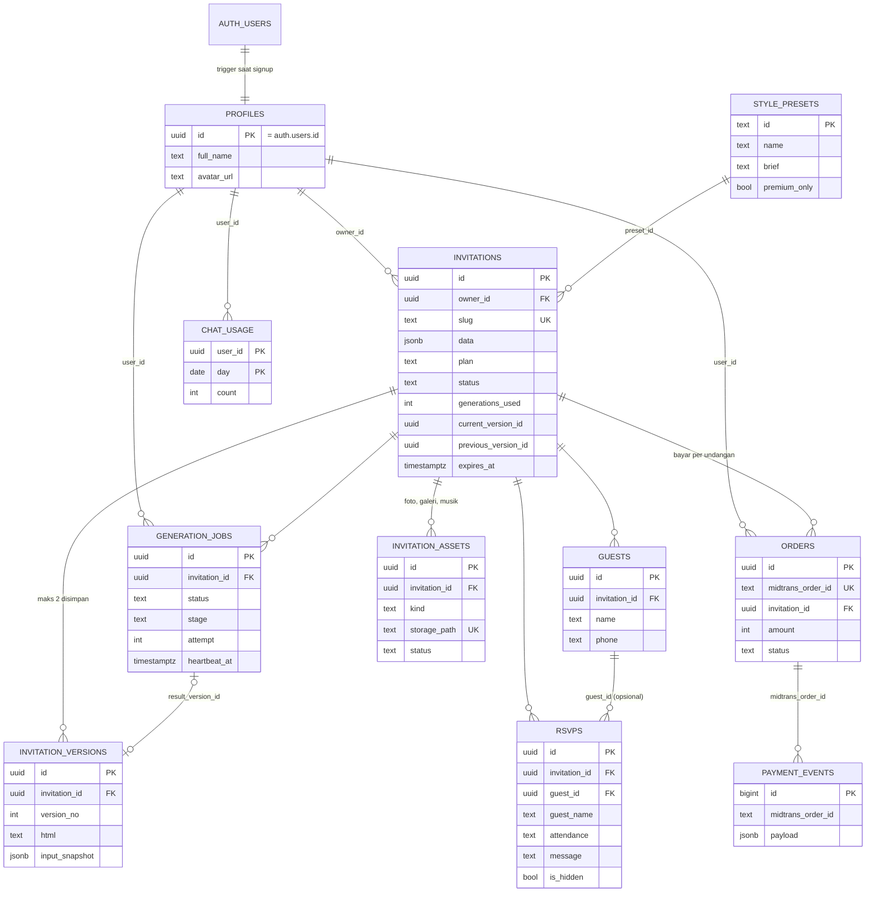

# 05 · Skema Database (Supabase baru)

Dokumen terkait: [04-arsitektur.md](04-arsitektur.md), [06-api-spec.md](06-api-spec.md),
[07-pipeline-generate-ai.md](07-pipeline-generate-ai.md), [08-rencana-refactor.md](08-rencana-refactor.md).
Sumber keputusan: [00](00-keputusan-dan-analisis.md) (Q5, Q7, Q13, Q16, Q17, Q20).

SQL migrasi lengkap ada di §7 (cermin `supabase/migrations/20261118000000_init.sql`, sudah diterapkan ke project `wiyrblibtzufwejmspib`; bila berbeda, berkas migrasi yang benar).
Skema lama tidak ada di repo, jadi tidak ada migrasi data (data lama diikhlaskan, Q5).

## 1. Prinsip

1. **Semua penulisan lewat backend (service-role, melewati RLS).** Klien (anon/authenticated) hanya boleh
   membaca barisnya sendiri; satu-satunya pengecualian tulis: `profiles.full_name/avatar_url`.
   Kolom sensitif (`plan`, `generations_used`, `expires_at`, status order) tidak pernah dapat ditulis klien.
2. **RLS aktif di semua tabel**; `anon` tidak punya kebijakan apa pun kecuali membaca `style_presets`.
   Halaman publik dan RSVP tamu dilayani backend (bukan akses langsung `anon` ke tabel).
3. **Premium = atribut undangan** (`invitations.plan`), karena bayar sekali per undangan (Q7). Tabel `tbl_m_subs`
   dan langganan bulanan dihapus.
4. **Operasi multi-langkah memakai fungsi SQL** (`commit_generation`, `mark_order_paid`, `rollback_invitation`,
   `consume_chat_quota`) karena client Python tidak punya transaksi. Fungsi hanya dapat dieksekusi `service_role`.
5. HTML hasil AI disimpan **sebelum** slot diisi (Q13): script/komponen sistem disuntik saat penyajian,
   sehingga dapat diperbaiki tanpa generate ulang, dan watermark mengikuti plan saat itu juga.
6. Nama kolom Inggris `snake_case`; label UI Indonesian ada di frontend.

## 2. ERD



## 3. Tabel

Tipe: `uuid` default `gen_random_uuid()`, waktu `timestamptz` default `now()`. Semua tabel punya `created_at`;
yang dapat diubah punya `updated_at` (trigger `set_updated_at`).

### 3.1 `profiles`
| Kolom | Tipe | Constraint |
|-------|------|------------|
| `id` | uuid | PK, FK `auth.users(id)` on delete cascade |
| `full_name` | text | null; ≤ 100 karakter |
| `avatar_url` | text | null |
| `created_at`, `updated_at` | timestamptz | |

Dibuat otomatis oleh trigger `on_auth_user_created` (nama dari metadata `full_name`/`name` Google, atau bagian
lokal email). Tidak ada kolom `email` (sumber: `auth.users`; backend mengambilnya dari JWT/`get_user`).

### 3.2 `style_presets` (Q18)
| Kolom | Tipe | Constraint |
|-------|------|------------|
| `id` | text | PK, `^[a-z0-9-]{2,40}$` |
| `name` | text | not null |
| `description` | text | null |
| `brief` | text | not null — "brief desain" (palet, mood, tipografi) yang dikirim ke AI |
| `preview_url` | text | null — gambar preview (statis di Vercel atau Storage; TBD) |
| `premium_only` | boolean | default false (Q17: pilihan gaya = premium) |
| `is_active` | boolean | default true |
| `sort_order` | int | default 0 |

Seed awal: `default` (gratis, arah visual Q10), `elegan`, `formal`, `simple` (premium, dari aset `mobile/assets/templates`;
`preview_url` masih kosong/TBD), dan `bebas` (premium; AI menentukan dari tema warna user). Brief gaya kelas contoh ini
boleh disetel ulang lewat dashboard Supabase atau migrasi baru (Q23).

### 3.3 `invitations`
| Kolom | Tipe | Constraint |
|-------|------|------------|
| `id` | uuid | PK |
| `owner_id` | uuid | not null, FK `profiles(id)` on delete cascade |
| `slug` | text | not null, **unik global**; `^[a-z0-9]+(-[a-z0-9]+)*$`, 3–40 karakter. **Tidak berubah** setelah dibuat (Q16) |
| `title` | text | not null, 1–120 (mis. "Adriel & Tiara"; diturunkan dari data) |
| `data` | jsonb | not null, bentuk `InvitationData` (lihat 06 §2.1), divalidasi Pydantic |
| `preset_id` | text | not null default `default`, FK `style_presets(id)` |
| `plan` | text | `free` \| `premium`, default `free`. **Hanya diubah `mark_order_paid`** |
| `status` | text | `draft` \| `published`, default `draft` |
| `generations_used` | int | default 0, ≥ 0 |
| `current_version_id` | uuid | FK `invitation_versions(id)` on delete set null |
| `previous_version_id` | uuid | FK `invitation_versions(id)` on delete set null (untuk rollback, Q16) |
| `published_at` | timestamptz | null; diisi pada generate sukses pertama |
| `expires_at` | timestamptz | null; gratis: `published_at + 30 hari`; premium: `paid_at + 365 hari` (Q17) |
| `created_at`, `updated_at` | timestamptz | |

Batas kuota (3 / 15) **bukan** kolom: ditentukan `services/plans.py` dari `plan` (satu sumber aturan).
Karena itu, saat upgrade, `generations_used` tidak di-reset (undangan gratis yang sudah 3× generate mendapat
sisa 12). **[Keputusan]**

### 3.4 `invitation_versions`
| Kolom | Tipe | Constraint |
|-------|------|------------|
| `id` | uuid | PK |
| `invitation_id` | uuid | not null, FK `invitations(id)` on delete cascade |
| `version_no` | int | not null > 0; unik bersama `invitation_id` |
| `html` | text | not null, ≤ 600.000 karakter; HTML **tersanitasi, slot belum diisi** (07) |
| `model` | text | not null (mis. `gemini-3.1-flash-lite`) |
| `preset_id` | text | null |
| `input_snapshot` | jsonb | not null; data + preset saat generate (reproduksibilitas) |
| `warnings` | jsonb | default `[]`; mis. `["slot_rsvp_missing_injected"]` |
| `created_at` | timestamptz | |

Hanya versi yang ditunjuk `current_version_id` dan `previous_version_id` yang disimpan (Q16); sisanya dihapus oleh
`commit_generation`. Rollback = menukar kedua penunjuk (bisa maju-mundur).

### 3.5 `invitation_assets`
| Kolom | Tipe | Constraint |
|-------|------|------------|
| `id` | uuid | PK |
| `invitation_id` | uuid | not null, FK cascade |
| `kind` | text | `cover` \| `groom` \| `bride` \| `gallery` \| `music` |
| `storage_path` | text | not null, **unik**; aturan path di §6 |
| `content_type` | text | not null |
| `size_bytes` | bigint | not null, > 0 |
| `position` | int | default 0 (urutan galeri) |
| `status` | text | `pending` (URL upload dibuat) \| `ready` (setelah `confirm`) |
| `created_at` | timestamptz | |

Satu aset `ready` per jenis untuk `cover/groom/bride/music` (indeks unik parsial `kind <> 'gallery' and status = 'ready'`, agar aset pengganti berstatus `pending` boleh ada sebelum `confirm`); galeri maks 10
(`GALLERY_MAX_PHOTOS`, ditegakkan service). Aset hanya untuk premium (Q17).

### 3.6 `guests` (Q20)
| Kolom | Tipe | Constraint |
|-------|------|------------|
| `id` | uuid | PK |
| `invitation_id` | uuid | not null, FK cascade |
| `name` | text | not null, 1–100 |
| `name_key` | text | generated `lower(btrim(name))`; unik bersama `invitation_id` (nama ganda ditolak/di-skip) |
| `phone` | text | null; format E.164 longgar `^\+?[0-9]{8,15}$` (untuk tombol WhatsApp) |
| `created_at`, `updated_at` | timestamptz | |

Link personal tidak disimpan: `https://<web>/u/<slug>?to=<nama>` dibentuk server (Q19). Batas 50 tamu (gratis)
ditegakkan service.

### 3.7 `rsvps`
| Kolom | Tipe | Constraint |
|-------|------|------------|
| `id` | uuid | PK |
| `invitation_id` | uuid | not null, FK cascade |
| `guest_id` | uuid | null, FK `guests(id)` on delete set null (tamu terdaftar bila nama cocok) |
| `guest_name` | text | not null, 1–100 |
| `name_key` | text | generated `lower(btrim(guest_name))` |
| `attendance` | text | `hadir` \| `tidak_hadir` |
| `message` | text | null, ≤ 500 (ucapan) |
| `is_hidden` | boolean | default false (pemilik dapat menyembunyikan ucapan) |
| `created_at` | timestamptz | |

**Hanya-tambah** (tanpa upsert): tamu yang mengirim ulang menambah baris; dashboard menghitung status terbaru per
`name_key` (`distinct on`). Ini mencegah tamu A menimpa RSVP tamu B dengan menebak nama. Spam dibatasi rate limit
backend (06 §11).

### 3.8 `orders` (Q7)
| Kolom | Tipe | Constraint |
|-------|------|------------|
| `id` | uuid | PK |
| `midtrans_order_id` | text | not null, unik; format `carta-<uuid>` (≤ 50 karakter) |
| `invitation_id` | uuid | not null, FK `invitations(id)` on delete cascade |
| `user_id` | uuid | not null, FK `profiles(id)` on delete cascade |
| `amount` | int | not null, > 0 (rupiah; dari `PREMIUM_PRICE_IDR`, B7) |
| `status` | text | `pending` \| `paid` \| `failed` \| `expired` \| `refunded` |
| `snap_token`, `redirect_url` | text | null |
| `payment_type`, `transaction_id`, `transaction_status`, `fraud_status` | text | null (dari notifikasi terakhir) |
| `paid_at` | timestamptz | null |
| `created_at`, `updated_at` | timestamptz | |

Indeks unik parsial: **satu order `pending` per undangan** (membuat order lagi mengembalikan yang masih berlaku).

### 3.9 `payment_events`
Log audit mentah setiap notifikasi/sinkronisasi Midtrans: `id bigint identity`, `midtrans_order_id`, `source`
(`webhook` \| `sync`), `payload jsonb`, `created_at`. Tanpa FK (notifikasi untuk order tak dikenal tetap tercatat).
Hanya service-role.

### 3.10 `generation_jobs` (Q15)
| Kolom | Tipe | Constraint |
|-------|------|------------|
| `id` | uuid | PK |
| `invitation_id` | uuid | not null, FK cascade |
| `user_id` | uuid | not null, FK `profiles(id)` cascade |
| `status` | text | `queued` \| `running` \| `succeeded` \| `failed` |
| `stage` | text | `queued` \| `validating` \| `prompting` \| `generating` \| `sanitizing` \| `injecting` \| `saving` \| `done` |
| `attempt` | int | default 0 |
| `error_code`, `error_message` | text | null |
| `input_snapshot` | jsonb | not null (data + preset + URL aset saat job dibuat) |
| `result_version_id` | uuid | null, FK `invitation_versions(id)` on delete set null |
| `heartbeat_at` | timestamptz | default now() |
| `started_at`, `finished_at` | timestamptz | null |
| `created_at` | timestamptz | |

Indeks unik parsial `(invitation_id) where status in ('queued','running')` = satu job aktif per undangan.

### 3.11 `chat_usage` (Q9)
`user_id uuid` (FK profiles cascade), `day date`, `count int`; PK `(user_id, day)`. Hari = tanggal WIB
(`Asia/Jakarta`) **[Keputusan]**; reset 00:00 WIB.

## 4. Indeks

| Indeks | Tujuan |
|--------|--------|
| `invitations (slug)` unik | Penyajian `/u/{slug}` |
| `invitations (owner_id, created_at desc)` | Daftar undangan |
| `invitation_versions (invitation_id, version_no)` unik | Nomor versi |
| `invitation_assets (invitation_id, kind)` unik parsial `kind <> 'gallery' and status = 'ready'` | Satu aset siap per jenis |
| `invitation_assets (invitation_id)` | Muat aset |
| `guests (invitation_id, name_key)` unik | Tanpa duplikat, pencocokan RSVP |
| `rsvps (invitation_id, created_at desc)` | Daftar ucapan |
| `rsvps (invitation_id, name_key, created_at desc)` | Status terbaru per tamu |
| `orders (user_id, created_at desc)`, `orders (invitation_id)` | Riwayat |
| `orders (invitation_id) where status='pending'` unik | Satu order pending |
| `generation_jobs (invitation_id) where status in ('queued','running')` unik | Satu job aktif |
| `generation_jobs (status, heartbeat_at) where status in ('queued','running')` | Pemulihan job |
| `invitation_assets (status, created_at) where status='pending'` | Pembersihan aset pending |

## 5. Kebijakan RLS

Backend memakai service-role (melewati RLS); kebijakan di bawah untuk **klien langsung** (anon/authenticated)
dan sebagai pertahanan berlapis bila key anon dipakai.

| Tabel | anon | authenticated (owner) | service-role |
|-------|------|-----------------------|--------------|
| `profiles` | — | SELECT baris sendiri; UPDATE hanya kolom `full_name`, `avatar_url` baris sendiri | semua |
| `style_presets` | SELECT yang `is_active` | SELECT yang `is_active` | semua |
| `invitations` | — | SELECT miliknya | semua |
| `invitation_versions` | — | SELECT bila undangannya miliknya | semua |
| `invitation_assets` | — | SELECT bila undangannya miliknya | semua |
| `guests` | — | SELECT bila undangannya miliknya | semua |
| `rsvps` | — | SELECT bila undangannya miliknya | semua |
| `orders` | — | SELECT miliknya | semua |
| `generation_jobs` | — | SELECT miliknya | semua |
| `payment_events`, `chat_usage` | — | — (tertutup; hak tabel di-revoke) | semua |

Tidak ada kebijakan INSERT/UPDATE/DELETE untuk `authenticated` selain `profiles`; hak `insert/update/delete`
pada semua tabel di-`revoke` dari `anon` dan `authenticated`. Fungsi SQL di §7 hanya dapat dieksekusi
`service_role`. Tamu tidak pernah mengakses tabel langsung: RSVP/ucapan lewat `/api/public/*` (rate limit).

## 6. Storage

| Item | Nilai |
|------|-------|
| Bucket | `invitation-assets` — **public read** (tag ``/`<audio>` di halaman tamu tanpa login) |
| Batas | `file_size_limit` 10 MB; `allowed_mime_types`: `image/jpeg`, `image/png`, `image/webp`, `audio/mpeg`, `audio/mp4`. Batas per jenis (gambar 5 MB) ditegakkan backend |
| Path | `invitations/{invitation_id}/{kind}/{asset_id}.{ext}` — `asset_id` uuid acak ⇒ tidak dapat ditebak; `kind` ∈ `cover|groom|bride|gallery|music` |
| Tulis | **Tidak ada** kebijakan INSERT/UPDATE/DELETE di `storage.objects` untuk anon/authenticated. Upload hanya lewat **signed upload URL** yang dibuat backend (service-role) setelah cek pemilik+premium+jumlah+tipe+ukuran (06 §5) |
| Hapus | Backend (service-role) saat hapus aset/undangan: hapus objek per prefix `invitations/{id}/` |
| Daftar objek | Tidak ada kebijakan SELECT ⇒ klien tak dapat melakukan `list`; URL publik tetap berfungsi |
| Kebijakan aplikasi | Tidak ada bucket lain di v2 (logo bank tidak dipakai: slot gift menampilkan teks nama bank) |

Catatan: bucket publik berarti siapa pun yang memegang URL dapat mengunduh foto. Ini wajar untuk undangan yang
memang dibagikan; sensitivitas dibatasi karena path memuat uuid acak dan listing ditutup. Format HEIC dari iPhone:
TBD (klien mengonversi ke JPEG sebelum upload bila perlu).

## 7. SQL migrasi awal

```sql
-- supabase/migrations/20261118000000_init.sql
-- CartaAI v2: skema awal. Idempoten sebisanya; jalankan pada project Supabase baru.

-- ---------------------------------------------------------------- utilitas
create or replace function public.set_updated_at()
returns trigger language plpgsql set search_path = '' as $$
begin
  new.updated_at = now();
  return new;
end $$;

-- ---------------------------------------------------------------- profiles
create table public.profiles (
  id          uuid primary key references auth.users(id) on delete cascade,
  full_name   text,
  avatar_url  text,
  created_at  timestamptz not null default now(),
  updated_at  timestamptz not null default now(),
  constraint profiles_full_name_len check (full_name is null or char_length(full_name) <= 100)
);
create trigger profiles_set_updated_at before update on public.profiles
  for each row execute function public.set_updated_at();

create or replace function public.handle_new_user()
returns trigger language plpgsql security definer set search_path = public as $$
begin
  insert into public.profiles (id, full_name, avatar_url)
  values (
    new.id,
    left(coalesce(
      nullif(new.raw_user_meta_data->>'full_name', ''),
      nullif(new.raw_user_meta_data->>'name', ''),
      split_part(new.email, '@', 1)
    ), 100),
    new.raw_user_meta_data->>'avatar_url'
  )
  on conflict (id) do nothing;
  return new;
end $$;

create trigger on_auth_user_created after insert on auth.users
  for each row execute function public.handle_new_user();

-- ---------------------------------------------------------------- style_presets
create table public.style_presets (
  id            text primary key check (id ~ '^[a-z0-9-]{2,40}$'),
  name          text not null,
  description   text,
  brief         text not null,
  preview_url   text,
  premium_only  boolean not null default false,
  is_active     boolean not null default true,
  sort_order    int not null default 0,
  created_at    timestamptz not null default now()
);

insert into public.style_presets (id, name, description, brief, premium_only, sort_order) values
  ('default', 'Editorial Romantis', 'Gaya bawaan: hangat, rapi, elegan.',
   'Editorial-romantis. Latar ivory/kertas hangat, teks tinta gelap (hijau tua atau cokelat tua), satu warna aksen (terracotta atau emas pudar). Tipografi: serif display (Fraunces atau Cormorant Garamond) untuk judul dan nama, sans bersih (Inter) untuk isi. Banyak ruang kosong, garis tipis, ornamen minimal. Jangan gunakan gradien ungu/biru.',
   false, 0),
  ('elegan', 'Elegan', 'Mewah dengan aksen emas dan serif klasik.',
   'Elegan dan mewah. Palet gading/krem atau hitam pekat dengan aksen emas pudar, ornamen garis halus dan bingkai tipis. Tipografi: serif klasik (Cormorant Garamond atau Playfair Display) untuk judul, sans ringan untuk isi. Suasana hangat, berkelas, tidak ramai.',
   true, 2),
  ('formal', 'Formal', 'Resmi, rapi, dan profesional.',
   'Formal dan tertata. Palet navy/hijau tua dengan putih gading, aksen satu warna tegas. Tata letak simetris, bingkai rapi, hierarki jelas. Tipografi: serif tegas (Libre Baskerville) untuk judul, sans bersih (Inter) untuk isi.',
   true, 3),
  ('simple', 'Simple', 'Bersih, minimalis, banyak ruang kosong.',
   'Minimalis modern. Latar putih/abu sangat muda, teks gelap, satu warna aksen lembut (pastel). Banyak ruang kosong, tanpa ornamen berat, sudut membulat halus. Tipografi: sans geometris (Poppins atau Inter) dengan satu serif display untuk nama.',
   true, 4),
  ('bebas', 'Bebas', 'AI menentukan gaya dari tema warna yang kamu tulis.',
   'Tentukan sendiri palet, mood, dan tipografi berdasarkan tema warna dan catatan gaya dari pengguna. Pertahankan keterbacaan (kontras teks cukup) dan nuansa elegan untuk pernikahan.',
   true, 9)
on conflict (id) do nothing;
-- Preset lain: ditambah lewat dashboard Supabase atau migrasi baru (Q23).

-- ---------------------------------------------------------------- invitations
create table public.invitations (
  id                   uuid primary key default gen_random_uuid(),
  owner_id             uuid not null references public.profiles(id) on delete cascade,
  slug                 text not null,
  title                text not null,
  data                 jsonb not null default '{}'::jsonb,
  preset_id            text not null default 'default' references public.style_presets(id),
  plan                 text not null default 'free',
  status               text not null default 'draft',
  generations_used     int  not null default 0,
  current_version_id   uuid,
  previous_version_id  uuid,
  published_at         timestamptz,
  expires_at           timestamptz,
  created_at           timestamptz not null default now(),
  updated_at           timestamptz not null default now(),
  constraint invitations_slug_format check (
    slug ~ '^[a-z0-9]+(-[a-z0-9]+)*$' and char_length(slug) between 3 and 40),
  constraint invitations_title_len check (char_length(title) between 1 and 120),
  constraint invitations_plan_valid check (plan in ('free', 'premium')),
  constraint invitations_status_valid check (status in ('draft', 'published')),
  constraint invitations_generations_nonneg check (generations_used >= 0)
);
create unique index invitations_slug_key on public.invitations (slug);
create index invitations_owner_created_idx on public.invitations (owner_id, created_at desc);
create index invitations_preset_idx on public.invitations (preset_id);
create trigger invitations_set_updated_at before update on public.invitations
  for each row execute function public.set_updated_at();

-- ---------------------------------------------------------------- invitation_versions
create table public.invitation_versions (
  id              uuid primary key default gen_random_uuid(),
  invitation_id   uuid not null references public.invitations(id) on delete cascade,
  version_no      int  not null check (version_no > 0),
  html            text not null check (char_length(html) between 1 and 600000),
  model           text not null,
  preset_id       text,
  input_snapshot  jsonb not null,
  warnings        jsonb not null default '[]'::jsonb,
  created_at      timestamptz not null default now(),
  unique (invitation_id, version_no)
);

alter table public.invitations
  add constraint invitations_current_version_fk
    foreign key (current_version_id) references public.invitation_versions(id) on delete set null,
  add constraint invitations_previous_version_fk
    foreign key (previous_version_id) references public.invitation_versions(id) on delete set null;
create index invitations_current_version_idx on public.invitations (current_version_id);
create index invitations_previous_version_idx on public.invitations (previous_version_id);

-- ---------------------------------------------------------------- invitation_assets
create table public.invitation_assets (
  id             uuid primary key default gen_random_uuid(),
  invitation_id  uuid not null references public.invitations(id) on delete cascade,
  kind           text not null check (kind in ('cover', 'groom', 'bride', 'gallery', 'music')),
  storage_path   text not null unique,
  content_type   text not null,
  size_bytes     bigint not null check (size_bytes > 0),
  position       int not null default 0,
  status         text not null default 'pending' check (status in ('pending', 'ready')),
  created_at     timestamptz not null default now()
);
create unique index invitation_assets_single_kind
  on public.invitation_assets (invitation_id, kind) where kind <> 'gallery' and status = 'ready';
create index invitation_assets_invitation_idx on public.invitation_assets (invitation_id);
create index invitation_assets_pending_idx
  on public.invitation_assets (created_at) where status = 'pending';

-- ---------------------------------------------------------------- guests
create table public.guests (
  id             uuid primary key default gen_random_uuid(),
  invitation_id  uuid not null references public.invitations(id) on delete cascade,
  name           text not null check (char_length(btrim(name)) between 1 and 100),
  name_key       text generated always as (lower(btrim(name))) stored,
  phone          text check (phone is null or phone ~ '^\+?[0-9]{8,15}$'),
  created_at     timestamptz not null default now(),
  updated_at     timestamptz not null default now()
);
create unique index guests_invitation_name_key on public.guests (invitation_id, name_key);
create trigger guests_set_updated_at before update on public.guests
  for each row execute function public.set_updated_at();

-- ---------------------------------------------------------------- rsvps
create table public.rsvps (
  id             uuid primary key default gen_random_uuid(),
  invitation_id  uuid not null references public.invitations(id) on delete cascade,
  guest_id       uuid references public.guests(id) on delete set null,
  guest_name     text not null check (char_length(btrim(guest_name)) between 1 and 100),
  name_key       text generated always as (lower(btrim(guest_name))) stored,
  attendance     text not null check (attendance in ('hadir', 'tidak_hadir')),
  message        text check (message is null or char_length(message) <= 500),
  is_hidden      boolean not null default false,
  created_at     timestamptz not null default now()
);
create index rsvps_invitation_created_idx on public.rsvps (invitation_id, created_at desc);
create index rsvps_invitation_name_idx on public.rsvps (invitation_id, name_key, created_at desc);
create index rsvps_guest_idx on public.rsvps (guest_id);

-- ---------------------------------------------------------------- orders
create table public.orders (
  id                  uuid primary key default gen_random_uuid(),
  midtrans_order_id   text not null unique,
  invitation_id       uuid not null references public.invitations(id) on delete cascade,
  user_id             uuid not null references public.profiles(id) on delete cascade,
  amount              int  not null check (amount > 0),
  status              text not null default 'pending'
                      check (status in ('pending', 'paid', 'failed', 'expired', 'refunded')),
  snap_token          text,
  redirect_url        text,
  payment_type        text,
  transaction_id      text,
  transaction_status  text,
  fraud_status        text,
  paid_at             timestamptz,
  created_at          timestamptz not null default now(),
  updated_at          timestamptz not null default now()
);
create index orders_user_created_idx on public.orders (user_id, created_at desc);
create index orders_invitation_idx on public.orders (invitation_id);
create unique index orders_one_pending_per_invitation
  on public.orders (invitation_id) where status = 'pending';
create trigger orders_set_updated_at before update on public.orders
  for each row execute function public.set_updated_at();

-- ---------------------------------------------------------------- payment_events
create table public.payment_events (
  id                 bigint generated always as identity primary key,
  midtrans_order_id  text,
  source             text not null check (source in ('webhook', 'sync')),
  payload            jsonb not null,
  created_at         timestamptz not null default now()
);
create index payment_events_order_idx on public.payment_events (midtrans_order_id);

-- ---------------------------------------------------------------- generation_jobs
create table public.generation_jobs (
  id                 uuid primary key default gen_random_uuid(),
  invitation_id      uuid not null references public.invitations(id) on delete cascade,
  user_id            uuid not null references public.profiles(id) on delete cascade,
  status             text not null default 'queued'
                     check (status in ('queued', 'running', 'succeeded', 'failed')),
  stage              text not null default 'queued'
                     check (stage in ('queued', 'validating', 'prompting', 'generating',
                                      'sanitizing', 'injecting', 'saving', 'done')),
  attempt            int  not null default 0,
  error_code         text,
  error_message      text,
  input_snapshot     jsonb not null,
  result_version_id  uuid references public.invitation_versions(id) on delete set null,
  heartbeat_at       timestamptz not null default now(),
  started_at         timestamptz,
  finished_at        timestamptz,
  created_at         timestamptz not null default now()
);
create unique index generation_jobs_one_active_per_invitation
  on public.generation_jobs (invitation_id) where status in ('queued', 'running');
create index generation_jobs_invitation_created_idx
  on public.generation_jobs (invitation_id, created_at desc);
create index generation_jobs_recovery_idx
  on public.generation_jobs (status, heartbeat_at) where status in ('queued', 'running');
create index generation_jobs_user_idx on public.generation_jobs (user_id);
create index generation_jobs_result_version_idx on public.generation_jobs (result_version_id);

-- ---------------------------------------------------------------- chat_usage
create table public.chat_usage (
  user_id  uuid not null references public.profiles(id) on delete cascade,
  day      date not null,
  count    int  not null default 0 check (count >= 0),
  primary key (user_id, day)
);

-- ================================================================ fungsi (hanya service_role)

-- Menyimpan hasil generate: versi baru, penunjuk versi, kuota, status job. Idempoten per job.
create or replace function public.commit_generation(
  p_job_id uuid, p_html text, p_model text, p_warnings jsonb, p_free_days int default 30
) returns uuid
language plpgsql security definer set search_path = public as $$
declare
  v_job public.generation_jobs%rowtype;
  v_inv public.invitations%rowtype;
  v_version_id uuid;
  v_next int;
begin
  select * into v_job from public.generation_jobs where id = p_job_id for update;
  if not found then raise exception 'job_not_found'; end if;
  if v_job.status = 'succeeded' then return v_job.result_version_id; end if;
  if v_job.status <> 'running' then raise exception 'job_not_running'; end if;

  select * into v_inv from public.invitations where id = v_job.invitation_id for update;

  select coalesce(max(version_no), 0) + 1 into v_next
    from public.invitation_versions where invitation_id = v_inv.id;

  insert into public.invitation_versions
    (invitation_id, version_no, html, model, preset_id, input_snapshot, warnings)
  values
    (v_inv.id, v_next, p_html, p_model, v_job.input_snapshot->>'preset_id',
     v_job.input_snapshot, coalesce(p_warnings, '[]'::jsonb))
  returning id into v_version_id;

  update public.invitations set
    previous_version_id = current_version_id,
    current_version_id  = v_version_id,
    generations_used    = generations_used + 1,
    status              = 'published',
    published_at        = coalesce(published_at, now()),
    expires_at          = case when plan = 'free' and expires_at is null
                               then now() + make_interval(days => p_free_days)
                               else expires_at end
  where id = v_inv.id;

  -- simpan hanya versi baru + versi sebelumnya (Q16)
  delete from public.invitation_versions
   where invitation_id = v_inv.id
     and id <> v_version_id
     and id is distinct from v_inv.current_version_id;

  update public.generation_jobs set
    status = 'succeeded', stage = 'done', result_version_id = v_version_id,
    finished_at = now(), heartbeat_at = now()
  where id = p_job_id;

  return v_version_id;
end $$;

-- Rollback: tukar versi aktif dan sebelumnya. Memeriksa pemilik.
create or replace function public.rollback_invitation(p_invitation_id uuid, p_owner_id uuid)
returns void
language plpgsql security definer set search_path = public as $$
declare v_inv public.invitations%rowtype;
begin
  select * into v_inv from public.invitations
   where id = p_invitation_id and owner_id = p_owner_id for update;
  if not found then raise exception 'not_found'; end if;
  if v_inv.previous_version_id is null then raise exception 'no_previous_version'; end if;
  update public.invitations set
    current_version_id = v_inv.previous_version_id,
    previous_version_id = v_inv.current_version_id
  where id = v_inv.id;
end $$;

-- Menandai order lunas dan menjadikan undangan premium. Idempoten: true hanya pada transisi pertama.
create or replace function public.mark_order_paid(
  p_midtrans_order_id text, p_transaction_id text, p_payment_type text,
  p_fraud_status text, p_premium_days int default 365
) returns boolean
language plpgsql security definer set search_path = public as $$
declare v_invitation uuid;
begin
  update public.orders set
    status = 'paid', paid_at = now(),
    transaction_status = 'settlement',
    transaction_id = coalesce(p_transaction_id, transaction_id),
    payment_type   = coalesce(p_payment_type, payment_type),
    fraud_status   = coalesce(p_fraud_status, fraud_status)
  where midtrans_order_id = p_midtrans_order_id and status = 'pending'
  returning invitation_id into v_invitation;
  if not found then return false; end if;

  update public.invitations set
    plan = 'premium',
    expires_at = now() + make_interval(days => p_premium_days)
  where id = v_invitation;
  return true;
end $$;

-- Kuota chat harian (hari WIB). Mengembalikan sisa kuota, atau -1 bila habis.
create or replace function public.consume_chat_quota(p_user_id uuid, p_limit int)
returns int
language plpgsql security definer set search_path = public as $$
declare
  v_day date := (now() at time zone 'Asia/Jakarta')::date;
  v_count int;
begin
  insert into public.chat_usage (user_id, day, count) values (p_user_id, v_day, 0)
    on conflict (user_id, day) do nothing;
  update public.chat_usage set count = count + 1
   where user_id = p_user_id and day = v_day and count < p_limit
  returning count into v_count;
  if not found then return -1; end if;
  return p_limit - v_count;
end $$;

create or replace function public.refund_chat_quota(p_user_id uuid)
returns void
language sql security definer set search_path = public as $$
  update public.chat_usage set count = greatest(count - 1, 0)
   where user_id = p_user_id and day = (now() at time zone 'Asia/Jakarta')::date;
$$;

revoke all on function public.handle_new_user() from public, anon, authenticated;
revoke all on function public.commit_generation(uuid, text, text, jsonb, int) from public, anon, authenticated;
revoke all on function public.rollback_invitation(uuid, uuid)                 from public, anon, authenticated;
revoke all on function public.mark_order_paid(text, text, text, text, int)    from public, anon, authenticated;
revoke all on function public.consume_chat_quota(uuid, int)                   from public, anon, authenticated;
revoke all on function public.refund_chat_quota(uuid)                         from public, anon, authenticated;
grant execute on function public.commit_generation(uuid, text, text, jsonb, int) to service_role;
grant execute on function public.rollback_invitation(uuid, uuid)                 to service_role;
grant execute on function public.mark_order_paid(text, text, text, text, int)    to service_role;
grant execute on function public.consume_chat_quota(uuid, int)                   to service_role;
grant execute on function public.refund_chat_quota(uuid)                         to service_role;

-- ================================================================ RLS
alter table public.profiles            enable row level security;
alter table public.style_presets       enable row level security;
alter table public.invitations         enable row level security;
alter table public.invitation_versions enable row level security;
alter table public.invitation_assets   enable row level security;
alter table public.guests              enable row level security;
alter table public.rsvps               enable row level security;
alter table public.orders              enable row level security;
alter table public.payment_events      enable row level security;
alter table public.generation_jobs     enable row level security;
alter table public.chat_usage          enable row level security;

create policy profiles_select_own on public.profiles
  for select to authenticated using (id = (select auth.uid()));
create policy profiles_update_own on public.profiles
  for update to authenticated
  using (id = (select auth.uid())) with check (id = (select auth.uid()));

create policy style_presets_select_active on public.style_presets
  for select to anon, authenticated using (is_active);

create policy invitations_select_own on public.invitations
  for select to authenticated using (owner_id = (select auth.uid()));

create policy invitation_versions_select_own on public.invitation_versions
  for select to authenticated using (exists (
    select 1 from public.invitations i
     where i.id = invitation_id and i.owner_id = (select auth.uid())));

create policy invitation_assets_select_own on public.invitation_assets
  for select to authenticated using (exists (
    select 1 from public.invitations i
     where i.id = invitation_id and i.owner_id = (select auth.uid())));

create policy guests_select_own on public.guests
  for select to authenticated using (exists (
    select 1 from public.invitations i
     where i.id = invitation_id and i.owner_id = (select auth.uid())));

create policy rsvps_select_own on public.rsvps
  for select to authenticated using (exists (
    select 1 from public.invitations i
     where i.id = invitation_id and i.owner_id = (select auth.uid())));

create policy orders_select_own on public.orders
  for select to authenticated using (user_id = (select auth.uid()));

create policy generation_jobs_select_own on public.generation_jobs
  for select to authenticated using (user_id = (select auth.uid()));

-- payment_events dan chat_usage: tanpa kebijakan (tertutup untuk anon/authenticated)

-- Hak tabel: klien tidak boleh menulis kecuali profil (kolom terbatas)
revoke insert, update, delete on all tables in schema public from anon, authenticated;
revoke all on public.payment_events, public.chat_usage from anon, authenticated;
grant update (full_name, avatar_url) on public.profiles to authenticated;

-- ================================================================ Storage
insert into storage.buckets (id, name, public, file_size_limit, allowed_mime_types)
values ('invitation-assets', 'invitation-assets', true, 10485760,
        array['image/jpeg', 'image/png', 'image/webp', 'audio/mpeg', 'audio/mp4'])
on conflict (id) do update set
  public = excluded.public,
  file_size_limit = excluded.file_size_limit,
  allowed_mime_types = excluded.allowed_mime_types;
-- Sengaja TANPA kebijakan di storage.objects: tulis hanya via signed upload URL / service-role.
```

Catatan implementasi untuk F1-1: setelah migrasi diterapkan, jalankan advisor keamanan Supabase dan uji RLS
dengan dua user (A tidak dapat `select` data B; `insert` langsung ke `invitations` oleh `authenticated` ditolak).
Penyesuaian kecil pada SQL saat diterapkan boleh dilakukan, asalkan dokumen ini diperbarui.

## 8. Pemetaan tabel lama → baru

| Lama | Baru | Catatan |
|------|------|---------|
| `tbl_user` | `profiles` | `id_user`→`id`, `fullname`→`full_name`; `email` dari `auth.users`; kolom `is_active/created_by/updated_by` dibuang. Pengisian lewat trigger, bukan insert di endpoint register |
| `tbl_m_subs` | — (dibuang) | Plan menjadi konstanta (`free`/`premium`) di `services/plans.py` dan kolom `invitations.plan` |
| `tbl_t_subs` | `orders` (+ `invitations.plan`, `expires_at`) | Langganan 30 hari → bayar sekali per undangan (Q7); `id_t_subs` jadi `midtrans_order_id` berformat `carta-<uuid>` |
| `tbl_t_invitation` | `invitations` | `invitation_link`→`slug` (kini unik, tak berubah); `id_template`→`current_version_id`; tambah `plan`, `status`, `generations_used`, `expires_at` |
| `tbl_t_invitation_content` | `invitations.data` (jsonb) + `invitations.title` | Pemetaan field: `groom_name/bride_name/groom_father/...`→`data.groom.*`/`data.bride.*`; `religion`→`data.religion`; `akad_date`→`data.event_date`; `akad_time/akad_location`→`data.ceremony.{time,location}`; `reception_*`→`data.reception.*`; `theme_color`→`data.color_theme`; `special_notes`→`data.notes`; `invitation_type`→`preset_id`; `custom_font` dibuang; `music_url`, `groom_photo`, `bride_photo`→`invitation_assets`. Bug waktu `WITA/WIB` pada kolom `time` hilang: zona waktu jadi `data.timezone` |
| `tbl_t_template_ai` | `invitation_versions` | Tabel template per generate → versi per undangan, maks 2 disimpan |
| `tbl_t_gallery` | `invitation_assets` (`kind='gallery'`) | |
| `tbl_t_guest` | `guests` | `guest_slug` dibuang (link pakai `?to=<nama>`, Q19); RSVP dari nama yang belum terdaftar tidak lagi membuat baris `guests` (hanya baris `rsvps`, `guest_id` null) |
| `tbl_t_rsvp` | `rsvps` | `attendance_status`→`attendance` (`hadir`/`tidak_hadir`); `message`→`message`; kini memuat `invitation_id` langsung (tanpa join via tamu) |
| Bucket `invitation-assets` | Bucket `invitation-assets` | Nama sama; path baru (§6); upload lewat signed URL |
| — | `style_presets`, `generation_jobs`, `payment_events`, `chat_usage` | Baru (Q15, Q18, B6/B8, Q9) |
