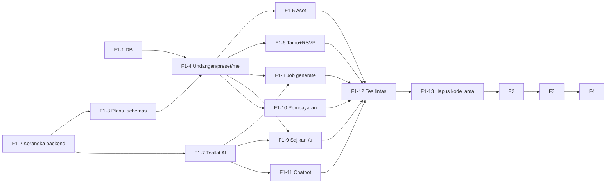

# 08 · Rencana Refactor F1–F4

Daftar tugas bertahap yang dapat dikerjakan sesi/orang lain. Turunan [00](00-keputusan-dan-analisis.md) (Q25: tiap
fase = PR terpisah ke `refactor/v2`), dengan acuan teknis [04](04-arsitektur.md), [05](05-skema-database.md),
[06](06-api-spec.md), [07](07-pipeline-generate-ai.md). Layar dan visual: `docs/01-prd.md`,
`docs/02-user-flow-dan-layar.md`, `docs/03-design-system.md` (ditulis sesi lain; tugas F2/F3 mengikutinya).
Disusun 2026-11-18. **TBD** = belum diputuskan (jangan dikarang).

## 1. Cara kerja

- Fase F1 → F2 → F3 → F4. Tiap fase satu cabang `refactor/v2-f<n>` dari `refactor/v2` dan satu PR kembali ke
  `refactor/v2`. Tugas di dalam fase = commit (atau cabang kecil yang digabung ke cabang fase).
- **Tugas paralel**: kerjakan di `git worktree` masing-masing (jangan satu folder bersama) agar tidak saling menimpa;
  kolom "Paralel dengan" menyatakan tugas yang berkas-berkasnya tidak bentrok.
- Kode **baru** ditulis berdampingan dengan kode lama; kode lama dihapus hanya di tugas penghapusan (F1-13, F2-5, F3-11),
  agar tiap tugas bisa digabung tanpa memutus yang lain.
- Prinsip (00 §4): perubahan terkecil, jangan tambah dependensi tanpa alasan, rahasia hanya lewat env.
- Dokumentasi pekerjaan sesuai instruksi pemilik (folder dokumentasi di luar repo) mengikuti kebijakan pemilik; di luar lingkup rencana ini.
- "Selesai bila" harus bisa dicek (perintah/tes/langkah manual). Perintah contoh dijalankan dari folder yang disebut.

## 2. Ringkasan dan ketergantungan

| Fase | Tujuan | Tugas |
|------|--------|-------|
| F1 | Supabase baru + migrasi + backend v2 + pytest (Q24) | F1-1 … F1-13 |
| F2 | Design system di kode + komponen dasar + fondasi klien | F2-0 … F2-5 |
| F3 | Semua layar web+mobile | F3-1 … F3-11 |
| F4 | Deploy Render/Vercel/EAS + QA | F4-1 … F4-8 |

## 3. Fase F1 — Database baru + backend v2

Cabang: `refactor/v2-f1`. Semua kode baru di `backend/app/` (04 §2.1); berkas lama (`backend/*.py`, `backend/routers/`)
tetap sampai F1-13.

### Tabel paralelisme F1
| Tugas | Bergantung pada | Paralel dengan |
|-------|-----------------|----------------|
| F1-1 DB | — (butuh akun Supabase pemilik) | F1-2, F1-7 (bagian murni) |
| F1-2 Kerangka | — | F1-1, F1-7 (sanitize/slots/prompt) |
| F1-3 Plans + schemas | F1-2 | F1-7 |
| F1-4 Undangan/preset/me | F1-2, F1-3 (F1-1 untuk uji nyata) | F1-7 |
| F1-5 Aset | F1-4 | F1-6, F1-8, F1-9, F1-10, F1-11 |
| F1-6 Tamu + RSVP | F1-4 | F1-5, F1-8, F1-9, F1-10, F1-11 |
| F1-7 Toolkit AI | F1-2 (hanya untuk `gemini.py`) | F1-1, F1-3, F1-4 |
| F1-8 Job generate | F1-4, F1-7 | F1-5, F1-6, F1-9, F1-10, F1-11 |
| F1-9 Sajikan `/u` | F1-4, F1-7 | F1-5, F1-6, F1-8, F1-10, F1-11 |
| F1-10 Pembayaran | F1-4 | F1-5, F1-6, F1-8, F1-9, F1-11 |
| F1-11 Chatbot | F1-2, F1-7 | F1-5 … F1-10 |
| F1-12 Tes lintas | F1-5 … F1-11 | — |
| F1-13 Hapus kode lama | F1-12 | — |

Titik bentrok yang dihindari: F1-2 membuat **berkas stub kosong** untuk semua router/schema/repo/service (nama pada 04 §2.1)
dan `main.py` sudah mendaftarkan semua router; tugas lain hanya mengisi berkasnya sendiri. Tiap tugas menulis tesnya
sendiri di `backend/tests/test_<area>.py`.

### F1-1 · Supabase baru dan migrasi
- **Berkas**: `supabase/migrations/<timestamp>_init.sql` (salin SQL 05 §7), `supabase/README.md` (cara menerapkan; tanpa rahasia).
- **Langkah**: (1) pemilik membuat project Supabase baru (region dekat; catat URL, anon key, service-role key — **jangan commit**);
  (2) terapkan migrasi (Supabase CLI `db push` atau tool MCP Supabase `apply_migration`); (3) set Auth: Site URL, Redirect URLs
  (04 §6.3), aktifkan email+password dan Google (pemilik menyiapkan OAuth client); (4) uji RLS dengan dua user uji.
- **Selesai bila**: migrasi sukses di project baru; `select` pada tabel dengan JWT user A tidak mengembalikan baris user B;
  `insert` langsung ke `invitations` oleh `authenticated` ditolak; signup membuat baris `profiles` otomatis;
  `execute` fungsi `commit_generation` oleh `authenticated` ditolak; bucket `invitation-assets` ada, `upload` anon ditolak;
  advisor keamanan Supabase tanpa temuan "RLS disabled". Catat `SUPABASE_URL` baru ke env dev (bukan ke repo).

### F1-2 · Kerangka backend
- **Berkas**: `backend/app/{main,config,logging_config,errors,db,deps}.py`, stub kosong semua `routers/*`, `schemas/*`, `repos/*`,
  `services/*`; `backend/requirements.txt` (baru), `requirements-dev.txt`, `.env.example`, `pytest.ini`,
  `tests/conftest.py` (env palsu, `TestClient`, override `get_current_user`, fake `get_supabase`).
- **Langkah**: `Settings` pydantic-settings dari 04 §6.1 (gagal cepat bila env wajib hilang); logging baku + middleware `X-Request-ID`;
  `AppError` + handler seragam (06 §1.1, termasuk `RequestValidationError`→`validation_error`, tak terduga→`internal_error`);
  `get_supabase()` tunggal; `get_current_user` (04 §3); `rate_limit` (limiter memori per IP+kunci, 06 §11); CORS (06 §11); `GET /healthz`; `/docs` dimatikan bila `APP_ENV=production`.
- **Selesai bila**: `uvicorn app.main:app` jalan dengan `.env` dev; `pytest -q` hijau (tes: format error 401/404/422/500,
  `/healthz`, `get_current_user` menolak header kosong/token salah); `grep -rn "print(" backend/app` kosong; tidak ada
  `os.environ` di luar `config.py`.

### F1-3 · Aturan plan dan skema Pydantic
- **Berkas**: `backend/app/services/plans.py`, `backend/app/schemas/{common,invitation,guest,rsvp,job,payment,chat}.py`,
  `backend/tests/test_plans.py`, `test_schemas.py`.
- **Langkah**: `plans.py` = satu sumber aturan (generasi 3/15, tamu 50/∞, galeri 10, hari aktif 30/365, daftar fitur premium: `gifts`,
  `color_theme`, aset, preset `premium_only`); `check_generation_quota`, `check_premium_fields`, `guest_limit`. Skema sesuai 06 §2
  termasuk `clean_text()` (07 §2) dan validasi `InvitationData`.
- **Selesai bila**: tes lulus untuk: batas kuota per plan, field premium pada plan gratis ditolak, normalisasi `<`/`>`/kontrol/panjang,
  enum `religion`/`timezone`, format `HH:MM` (kasus `"09.00 WITA"` ditolak dengan pesan jelas).

### F1-4 · Undangan, preset, profil
- **Berkas**: `routers/{invitations,presets,me}.py`, `services/invitations.py`, `repos/{invitations,versions,presets,profiles}.py`,
  `tests/test_invitations.py`.
- **Langkah**: endpoint 06 §3–§4 kecuali `generate`/`jobs`/`assets` (generate ada di `routers/jobs.py`, F1-8): `slug-available`, buat/daftar/detail/ubah/hapus, `rollback` (RPC),
  `me`, `presets`. Semua query berpagar `owner_id`; objek orang lain → `404`. Hapus undangan juga menghapus objek Storage
  prefix `invitations/{id}/`. `public_url` dari `WEB_BASE_URL`.
- **Selesai bila**: tes: user B `GET/PATCH/DELETE/rollback` undangan user A → `404`; slug ganda → `409 slug_taken`; slug tak valid → `422`;
  preset premium pada gratis → `403 premium_required`; field `gifts` pada gratis → `403`; `PATCH` tidak mengubah slug/plan; jumlah
  undangan melewati `MAX_INVITATIONS_PER_USER` → `403`; respons `Invitation` sesuai 06 §2.2.

### F1-5 · Aset (signed upload URL)
- **Berkas**: `routers/assets.py`, `services/assets.py`, `repos/assets.py`, `tests/test_assets.py`.
- **Langkah**: `upload-url` (cek pemilik, premium, jenis, MIME, ukuran, batas galeri; buat baris `pending`; `create_signed_upload_url`),
  `confirm` (HEAD URL publik, cek ukuran, `ready`, ganti aset lama jenis tunggal), `DELETE`. Bersihkan aset `pending` > 24 jam saat startup
  (hook di `generation.py` lifespan sudah disediakan F1-2; di sini fungsinya `assets.cleanup_pending()` — didaftarkan F1-8).
- **Selesai bila**: tes: gratis → `403 premium_required`; MIME salah → `415`; ukuran > batas → `413`; galeri ke-11 → `403 asset_limit_reached`;
  bukan pemilik → `404`; `confirm` tanpa berkas → `409 asset_not_uploaded`; manual: unggah berkas nyata lewat token ke Supabase dev
  berhasil dan URL publik terbuka.

### F1-6 · Tamu, RSVP, endpoint publik
- **Berkas**: `routers/{guests,rsvps,public}.py`, `services/{guests,rsvps}.py`, `repos/{guests,rsvps}.py`, rate limiter di `deps.py`
  bagian `rate_limit` (milik F1-2; di sini hanya dipakai), `tests/test_guests.py`, `tests/test_rsvps.py`.
- **Langkah**: 06 §6–§7: CRUD tamu + `bulk` (semua-atau-tidak untuk batas, skip duplikat), dashboard RSVP + statistik "status terbaru per nama",
  sembunyikan ucapan, publik POST/GET dengan rate limit, CORS `*` untuk `/api/public/*`, pencocokan nama→`guest_id`, `410` untuk kedaluwarsa.
- **Selesai bila**: tes: user B `DELETE /api/guests/{id}` milik A → `404` (B3); bulk 51 pada gratis → `403` dan 0 tersimpan; duplikat nama di-skip;
  RSVP publik ke slug draft → `404`, kedaluwarsa → `410`; kiriman ke-6 dalam semenit → `429`; GET publik tidak memuat `is_hidden=true`;
  statistik benar pada kasus: satu tamu kirim dua RSVP (dihitung terbaru).

### F1-7 · Toolkit AI (modul murni)
- **Berkas**: `services/ai/{sanitize,slots,prompt,gemini}.py`, `services/ai/runtime.js` (kerangka dulu, diselesaikan F1-9), `tests/test_sanitize.py`,
  `test_slots.py`, `test_input_clean.py`, `test_gemini.py`. Tambah dependensi `google-genai`, `beautifulsoup4`, `html5lib` ke `requirements.txt`.
- **Langkah**: implementasi 07 §3–§5: `sanitize(html, ctx)`, `ensure_slots(html, ctx)`, `build_messages(snapshot, preset)`,
  `generate_html(prompt, keys, …)` dengan fallback key dan retry (SDK dipalsukan di tes); kerangka prompt 07 §3.2 diisi teks final dan
  satu contoh kerangka HTML.
- **Selesai bila**: 21 kasus sanitasi 07 §9 + kasus slot + escape input hijau; `test_gemini.py` membuktikan: 429 pada key utama → key fallback dipakai,
  semua key 429 → `ai_rate_limited`, timeout → `ai_unavailable`, key tidak muncul di log (`caplog`). Tanpa panggilan jaringan di tes. Satu uji manual (skrip
  di `backend/scripts/`, tanpa commit key) memanggil Gemini asli sekali dan menyimpan keluaran untuk disetel (`temperature`, token — 07 §3.1).

### F1-8 · Job generate
- **Berkas**: `routers/jobs.py` (memuat `GET /api/jobs/{id}` **dan** `POST /api/invitations/{id}/generate`, agar `routers/invitations.py` milik F1-4 tidak disentuh),
  `services/generation.py`, `repos/jobs.py`, `main.py` lifespan (memanggil `recover_stale_jobs()` dan `assets.cleanup_pending()`; satu-satunya
  perubahan `main.py` di fase ini), `tests/test_generation.py`.
- **Langkah**: 04 §4 + 07 §1/§7/§8: `POST generate` (urutan cek 06 §4), `run_job` (claim atomik, tahap, heartbeat, `Semaphore(2)`, RPC `commit_generation`),
  `GET /api/jobs/{id}` (dengan `recover_stale_jobs`), pemetaan galat → `error_code`.
- **Selesai bila**: tes dengan Gemini palsu: sukses → versi baru + `generations_used+1` + job `succeeded`; kuota habis → `403 quota_exceeded` (B1) tanpa memanggil Gemini;
  data wajib kosong → `409 nothing_to_generate`; job aktif → `409 job_in_progress`; undangan orang lain → `404` (B2); output invalid 3× → `failed`, kuota tetap;
  `recover_stale_jobs` mengantri ulang lalu `worker_lost`; generate ke-3 dan ke-4 pada gratis (Q16); dua versi tersimpan dan `rollback` menukar (integrasi bila F1-1 siap).

### F1-9 · Penyajian `/u/{slug}`
- **Berkas**: `routers/serve.py`, `services/ai/slots.py` (bagian pengisian saat penyajian), `services/ai/runtime.js` (final), `tests/test_serve.py`.
- **Langkah**: 07 §5.3 dan §6: ambil versi aktif, sanitasi ulang, nonce, config `__CARTA__`, `runtime.js`, watermark gratis, header CSP/`nosniff`/`noindex`/cache,
  halaman `404`/`410` HTML. Selesaikan `runtime.js` (RSVP, ucapan, countdown, musik, gift, guest-name, open) tanpa `localStorage`.
- **Selesai bila**: tes header (nonce unik, `sandbox` ada, host dari env); `404` draft, `410` kedaluwarsa; gratis ada watermark, premium tidak; `?to=` tak merender HTML dari query.
  **Manual di browser nyata** (dokumentasikan hasil di PR): halaman contoh berjalan di bawah CSP — RSVP terkirim, countdown jalan, tidak ada error CSP di konsol, Tailwind CDN
  berfungsi atau keputusan 07 §6 (opsi a/b) diajukan ke pemilik; halaman tidak dapat membaca `localStorage` aplikasi (uji dari konsol iframe).

### F1-10 · Pembayaran dan webhook
- **Berkas**: `routers/payments.py`, `services/payments.py`, `repos/orders.py`, `tests/test_payments.py`.
- **Langkah**: 06 §9: `POST /api/payments/orders` (pakai ulang order pending, harga dari `PREMIUM_PRICE_IDR`, `MIDTRANS_IS_PRODUCTION` dari env), `GET orders/{id}` + `sync_order`
  (Midtrans Status API), `POST /api/payments/webhook` (signature `hmac.compare_digest`, cocokkan nominal, tabel aturan status, RPC `mark_order_paid`, `payment_events`).
- **Selesai bila** (tes dengan signature dihitung di tes): signature salah → `403`; `settlement` → order `paid` + undangan `premium` + `expires_at` ≈ +365 hari;
  event sama dikirim 2× → perubahan hanya sekali; `capture` tanpa `fraud_status` → `paid` (B6); `capture`+`challenge` → tetap `pending`; `expire` setelah `settlement` → tetap `paid`;
  `pending` setelah `settlement` diabaikan; nominal berbeda → tidak aktif; order tak dikenal → `200 ignored`; error DB → `500`; `already_premium` → `409`; order pending dipakai ulang;
  `grep -rn "99000\|is_production=False" backend/app` kosong (B7). Manual (F4-4): sandbox Midtrans end-to-end.

### F1-11 · Chatbot
- **Berkas**: `routers/chat.py`, `services/chat.py`, `repos/chat_usage.py`, `tests/test_chat.py`; prompt sistem chat di `services/ai/prompt.py` (bagian `CHAT_SYSTEM_PROMPT`).
- **Langkah**: 06 §10: wajib JWT, `consume_chat_quota(user, CHAT_DAILY_LIMIT)` sebelum Gemini, `refund_chat_quota` bila gagal, potong riwayat 10, tulis ulang prompt sesuai Q17
  (Gratis: data inti, watermark, 3× generate, 30 hari, 50 tamu; Premium Rp99.000 per undangan: foto, galeri maks 10, musik, rekening, gaya, 15× generate, 1 tahun, tamu tak terbatas).
- **Selesai bila**: tes: tanpa token → `401` (B4); pesan ke-21 pada hari WIB yang sama → `429 chat_limit_reached`; Gemini gagal → kuota dikembalikan dan `502`; `GET /api/chat/usage` benar;
  riwayat > 10 dipotong; pesan > 1000 karakter → `422`.

### F1-12 · Tes lintas (cakupan Q24)
- **Berkas**: `tests/test_ownership_matrix.py`, `tests/integration/` (ditandai `@pytest.mark.integration`, dibaca dari `TEST_SUPABASE_URL`/`TEST_SUPABASE_SERVICE_ROLE_KEY`, dilewati bila kosong),
  `backend/README.md` (cara jalankan lokal dan tes), `.github/workflows/backend-tests.yml` (opsional — **TBD**, hanya bila pemilik ingin CI).
- **Langkah**: tes berparameter yang memanggil **setiap** endpoint pemilik dengan user B pada objek user A → semua `404`; peta ke empat area Q24 (webhook: F1-10; kepemilikan: F1-12 + F1-4/5/6;
  premium & kuota: F1-3/F1-8; sanitasi: F1-7); tes integrasi ke project Supabase uji (RLS, `commit_generation`, `mark_order_paid` benar-benar atomik/idempoten, unik pending).
  Catatan jujur: tes unit memakai repo palsu sehingga **filter `owner_id` pada query SQL sebenarnya hanya terbukti oleh tes integrasi** — jalankan sebelum PR digabung.
- **Selesai bila**: `pytest -q` hijau tanpa jaringan; `pytest -m integration` hijau terhadap project uji; matriks kepemilikan mencakup seluruh endpoint di 06 yang memakai `{id}`;
  `pytest --cov=app` dilaporkan (target tidak diwajibkan; laporkan angka).

### F1-13 · Hapus kode lama backend (Q8)
- **Berkas dihapus**: `backend/main.py`, `backend/dependencies.py`, `backend/ai_generator.py`, `backend/ai_generator_free.py`, `backend/tools_upload_banks.py`,
  `backend/routers/{auth,chatbot,invitations,midtrans,payments,__init__}.py`; `backend/__pycache__`/`venv` tidak di-commit (cek `.gitignore`). Perbarui `README.md` root (cara jalan backend baru).
- **Selesai bila**: `git ls-files backend` hanya berisi `app/`, `tests/`, berkas konfigurasi; `uvicorn app.main:app` dan `pytest -q` hijau; tidak ada rujukan ke `tbl_`,
  `GOOGLE_API_KEY`, `railway`, `google.generativeai` (`grep -rni`); `.env` tidak ter-track. **Pemilik**: me-rotate kunci lama (Midtrans, Gemini) — dicatat di PR (bukan nilainya).
- Cabang fase F1 → PR ke `refactor/v2`. Lampirkan hasil `pytest`, ringkasan tes manual F1-1/F1-9.

## 4. Fase F2 — Design system dan fondasi klien

Cabang: `refactor/v2-f2`. Acuan visual: `docs/03-design-system.md` (Q10: editorial-romantis, serif display + sans, satu aksen, dark mode).

| Tugas | Bergantung pada | Paralel dengan |
|-------|-----------------|----------------|
| F2-0 Dependensi & konfigurasi | — | — (kerjakan pertama) |
| F2-1 Tokens & tema | F2-0 | F2-3, F2-5 |
| F2-2 Komponen dasar | F2-1 | F2-3, F2-5 |
| F2-3 Fondasi data klien | F2-0 | F2-1, F2-2, F2-5 |
| F2-4 Auth, guard, root layout | F2-1, F2-3 | F2-2, F2-5 |
| F2-5 Hapus kode mati frontend | — | semua (berkas terpisah) |

### F2-0 · Dependensi dan konfigurasi
- **Berkas**: `mobile/package.json`, `mobile/app.json`, `mobile/tsconfig.json`, `mobile/eas.json` (env per profil, belum nilai), `mobile/.env.example`.
- **Langkah**: tambah `@tanstack/react-query`, font (`expo-font` + paket Google Fonts sesuai 03), devDependency `openapi-typescript`; alias `@/` bila belum;
  `app.json`: `web.output: "static"` dipertahankan, nama/slug/scheme tetap; skrip `gen:api`, `web:export` (`expo export -p web`); `.env.example` 4 variabel 04 §6.2.
- **Selesai bila**: `npx expo-doctor` tanpa error baru; `npx tsc --noEmit` tidak lebih buruk dari sebelumnya; `npx expo export -p web` sukses.

### F2-1 · Tokens dan tema
- **Berkas**: `mobile/src/theme/{tokens,typography,ThemeProvider,useTheme}.ts(x)`, `mobile/src/context/DarkModeContext*` digantikan (lihat F2-5/F3-11).
- **Langkah**: terjemahkan 03 ke token (warna semantik light/dark: `bg`, `surface`, `ink`, `muted`, `accent`, `border`, `danger`, `success`; skala spasi/radius/bayangan;
  tipografi display serif + sans; breakpoint responsif mobile/tablet/desktop). Muat font; dark mode mengikuti sistem + pilihan manual tersimpan.
- **Selesai bila**: tak ada literal warna di `src/theme` selain definisi token; layar uji menampilkan palet light/dark dan semua gaya teks; `grep -rn "#6366f1\|#667eea\|#764ba2" mobile/src/theme` kosong.

### F2-2 · Komponen dasar
- **Berkas**: `mobile/src/components/ui/*` (Screen/Container responsif, Text, Button, Input, TextArea, Select, Card, Badge, Sheet/Modal, Toast, Spinner/Skeleton, EmptyState, ErrorState, Stepper),
  satu rute dev `mobile/app/_dev/components.tsx` (tidak masuk produksi — kecualikan di build).
- **Selesai bila**: semua komponen hanya memakai token; tampil benar di iOS/Android/web light+dark (tangkapan layar di PR); fokus keyboard dan `accessibilityLabel` pada kontrol interaktif;
  tidak ada `StyleSheet` dengan warna literal.

### F2-3 · Fondasi data klien
- **Berkas**: `mobile/src/lib/{env,supabase,api,api-schema.d.ts,queryClient}.ts`, `mobile/src/features/*/api.ts` + `hooks.ts` untuk: invitations, generator (jobs), guests, rsvp, payments, chat, presets, me.
- **Langkah**: `env.ts` memvalidasi 4 variabel (gagal jelas bila hilang; **tanpa fallback ke Railway**); `supabase.ts` (storage web vs native, `detectSessionInUrl` hanya web);
  `api.ts`: `request<T>()` menempel JWT, timeout 60 dtk + retry backoff untuk cold start, menormalkan error 06 §1.1 ke `ApiError{code,message,details}`; `gen:api` menghasilkan `api-schema.d.ts`
  dari `/openapi.json` backend F1; pembungkus per endpoint 06 + hook TanStack Query (polling job 2–3 dtk, polling order 3 dtk, invalidasi cache).
- **Selesai bila**: `npm run gen:api` berjalan terhadap backend lokal; `tsc --noEmit` hijau; tes unit kecil (jest atau skrip) untuk normalisasi error & retry (**TBD** kerangka tes frontend — bila belum ada, cukup skrip verifikasi manual dicatat);
  tidak ada `supabase.from(` di `mobile/src` (`grep`); upload aset memakai `uploadToSignedUrl`.

### F2-4 · Auth, guard rute, root layout
- **Berkas**: `mobile/app/_layout.tsx`, `mobile/app/(auth)/_layout.tsx`, `mobile/app/app/_layout.tsx`, `mobile/src/features/auth/{AuthProvider,useAuth}.tsx`.
- **Langkah**: `AuthProvider` hanya `session`/`user` dari Supabase (tanpa membaca `tbl_t_subs`/`tbl_user`; premium tidak ada di sini); guard: folder `app/app/` memerlukan sesi, `(auth)` mengalihkan bila sudah login;
  provider urut Theme → QueryClient → Auth; Google OAuth (web redirect + native `expo-web-browser`).
- **Selesai bila**: login email+password dan Google berjalan terhadap Supabase dev di web dan satu perangkat/emulator; refresh halaman web mempertahankan sesi; rute `/app/*` tanpa sesi → ke login.

### F2-5 · Hapus kode mati frontend (Q8)
- **Dihapus**: `mobile/src/components/BlockchainPayment.tsx`, `mobile/src/screens/{FreeGeneratorScreen,PremiumGeneratorScreen}.tsx`, aset contoh Expo (`react-logo*`, `partial-react-logo` di `mobile/assets/images`),
  hanya setelah `grep` memastikan tidak ada import tersisa.
- **Selesai bila**: `tsc --noEmit` dan `npx expo export -p web` tetap sukses; `git grep -n "BlockchainPayment\|FreeGeneratorScreen\|PremiumGeneratorScreen\|react-logo"` kosong.
- Cabang F2 → PR ke `refactor/v2`.

## 5. Fase F3 — Semua layar web + mobile

Cabang: `refactor/v2-f3`. Layar, urutan, dan salinan teks mengikuti `docs/01-prd.md` dan `docs/02-user-flow-dan-layar.md`. Semua layar responsif (satu codebase; tata letak mobile ↔ desktop, Q3),
memakai komponen F2-2 dan hook F2-3, light/dark. Data hanya lewat API (06). Setiap tugas: route di `mobile/app/...` tipis + screen di `mobile/src/features/<fitur>/screens/`.

| Tugas | Cakupan | Bergantung pada | Paralel dengan |
|-------|---------|-----------------|----------------|
| F3-1 Landing & pemasaran | `/`, harga, galeri gaya (preset), tentang; static rendering + meta SEO | F2 | F3-2 … F3-9 |
| F3-2 Auth | login, daftar, lupa & ubah password, callback OAuth | F2-4 | F3-1, F3-3 … F3-9 |
| F3-3 Dashboard | daftar undangan, kartu status (plan, masa aktif, kuota), buat baru, hapus | F2 | F3-1, F3-2, F3-7 … F3-9 |
| F3-4 Form generator | wizard data (mempelai, orang tua, acara, lokasi, preset/tema, rekening), validasi, simpan draft, upload aset premium (cover, foto, galeri ≤ 10, musik), kunci fitur premium dengan ajakan upgrade | F2, F1-4/F1-5 | F3-1, F3-2, F3-6 … F3-9 |
| F3-5 Progres & hasil | layar progres job (polling, tahap, galat + coba lagi), hasil: link, salin/bagikan, pratinjau, generate ulang (sisa kuota), rollback | F2, F1-8; layar dari F3-4 untuk memicu | F3-6 … F3-9 |
| F3-6 Tamu & RSVP | daftar tamu, tambah/ubah/hapus, impor teks/CSV (web), link personal, kirim WhatsApp dengan template pesan yang dapat diedit, dashboard RSVP (hadir/tidak/ucapan, sembunyikan) | F2, F1-6 | F3-1 … F3-5, F3-7 … F3-9 |
| F3-7 Pembayaran | ringkasan harga, buat order, buka `redirect_url` (web: tab; mobile: WebView/browser), halaman `/app/pembayaran/[orderId]` (tujuan callback Midtrans), polling status, sukses/gagal/pending | F2, F1-10 | semua lain |
| F3-8 Chatbot | layar chat, sisa kuota harian, galat 429 yang ramah | F2, F1-11 | semua lain |
| F3-9 Profil | profil, ganti nama, ganti tema (light/dark), keluar | F2 | semua lain |
| F3-10 Responsif, a11y, dark mode | lintasi semua layar di lebar 360/768/1280; fokus keyboard, kontras, label; empty/error/loading state | F3-1 … F3-9 | — |
| F3-11 Hapus layar & kode lama | `mobile/src/screens/*` lama (kecuali yang sudah dipindahkan), `mobile/src/components/` lama yang tak dipakai, `src/supabaseClient.ts`, `src/context/*` lama, `WEDDING_TEMPLATES`/`PRICING_PLANS` konstanta (diganti preset dari API / konfigurasi di F3-1), rute lama (`midtrans-payment`, `template-usage`), folder `frontend/` sisa (hanya `node_modules` dan `.env`, tidak ter-track git; hapus lokal) | F3-10 | — |

Titik bentrok yang dihindari: F2-4 sudah memiliki `app/_layout.tsx`; tiap tugas F3 hanya menambah file route di folder grupnya sendiri. Navigasi bersama (tab/sidebar `app/app/_layout.tsx`): daftar rute disusun
F3-3 (pemilik berkas), tugas lain menambah rute ke daftar itu lewat PR kecil.

**Selesai bila (per tugas F3)**: layar sesuai alur di 02; tiga state (loading/kosong/galat) tampil; berjalan di web dan salah satu dari Android/iOS; tak ada warna literal dan tak ada `fetch` langsung ke backend di luar `lib/api.ts`;
`tsc --noEmit` hijau; tangkapan layar light+dark di deskripsi PR. **Selesai bila (F3-11)**: `git grep -n "tbl_\|supabaseClient\|railway\|#6366f1\|#667eea\|#764ba2" mobile/` kosong; tidak ada berkas > 400 baris (GeneratorScreen 1.522 baris terpecah);
`npx expo export -p web` sukses. Cabang F3 → PR ke `refactor/v2`.

## 5b. Fase F3b — Situs publik `web/` dan polesan app (Q26)

Dikerjakan di `refactor/v2` setelah F3. Situs publik Next.js di `web/` (Beranda, Template + 9 detail, Harga, Tentang,
Kebijakan Privasi dan Syarat & Ketentuan sebagai draf); landing Expo (`mobile/app/(marketing)`) dihapus dan `/` di app
mengarah ke `/app`. App Expo: transisi masuk layar (Reanimated) dan tombol bantuan mengambang (`ChatFab`).
Skill pengguna `modern-web-ui` mencatat pola dan resep animasinya.

**Selesai bila**: `next build` sukses; uji tangkapan layar 375/768/1440 dan `prefers-reduced-motion` tanpa error konsol
dan tanpa scroll horizontal; `tsc --noEmit` di `mobile/` bersih.

## 6. Fase F4 — Deploy dan QA

Cabang: `refactor/v2-f4`. Banyak langkah memerlukan akun/rahasia pemilik (ditandai **Pemilik**).

| Tugas | Isi | Paralel dengan |
|-------|-----|----------------|
| F4-1 Render | `render.yaml` (root dir `backend`, build `pip install -r requirements.txt`, start `uvicorn app.main:app --host 0.0.0.0 --port $PORT`, health check `/healthz`, env 04 §6.1, `PYTHON_VERSION`); **Pemilik** mengisi env rahasia; ping uptime `/healthz?deep=1` tiap ±10 menit; verifikasi ulang batasan free (04 §4) | F4-2, F4-3 |
| F4-2 Vercel | Project `web/` (Q26): ganti `HOST-RENDER-TBD` di `web/vercel.json` dengan host Render, set `NEXT_PUBLIC_APP_URL`, build `next build` (output `out`). Project `mobile/`: `vercel.json`: fallback rute dinamis Expo (`/app/undangan/:id` → `/app/undangan/[id].html`, dst., **verifikasi** hasil `expo export`), header keamanan app; env 04 §6.2; build `npx expo export -p web`, output `dist`; set `CORS_ALLOWED_ORIGINS`/`WEB_BASE_URL` di Render; **verifikasi** cache rewrite (04 §4 poin 5) | F4-1, F4-3 |
| F4-3 EAS | `eas.json` env per profil (`preview` APK internal; `production`), nilai `EXPO_PUBLIC_*`; build Android preview; iOS **TBD** (akun Apple Developer) | F4-1, F4-2 |
| F4-4 Midtrans sandbox | Set Payment Notification URL ke `/api/payments/webhook`; uji VA, e-wallet, kartu (kasus `fraud_status` kosong = B6), kedaluwarsa, bayar lalu tutup app (sinkronisasi `GET order`); **production: TBD** (akun belum ada) | F4-5 setelah F4-1/2 |
| F4-5 Rotasi & rahasia | **Pemilik** me-rotate/mencabut kunci lama (Midtrans, Gemini, Supabase lama); pastikan `.env` tidak ter-track (`git ls-files | grep -i env`); cek riwayat git untuk rahasia (**TBD** pembersihan riwayat) | F4-1 … F4-3 |
| F4-6 Header & keamanan | Uji nyata: CSP `/u/*` (tidak ada pelanggaran), sandbox (tidak bisa baca storage app), `X-Robots-Tag`, CORS tidak `*` di luar `/api/public`; uji XSS dengan nama/ucapan berisi `<script>`/`` | F4-4 |
| F4-7 QA manual | Tulis dan jalankan `docs/09-checklist-qa.md` (Q24 frontend): register/login/Google/lupa password; buat → generate → buka link di HP; gratis: batasan (tanpa foto, watermark, 3× generate, 50 tamu); bayar → premium aktif → watermark hilang → 15× generate; rollback; RSVP dari link tamu + ucapan; impor tamu + WhatsApp; chatbot 20/hari; Render tidur (request pertama), job pulih; web desktop + mobile; dark mode | setelah F4-1…F4-6 |
| F4-8 Dokumentasi & rilis | `README.md` root (jalankan lokal, env, deploy), perbarui 00 (tanda "selesai"), PR final `refactor/v2` → `main` (**Pemilik** menyetujui) | terakhir |

**Selesai bila (F4)**: URL web (domain Vercel) dan API (Render) aktif; link undangan contoh `https://<domain-web>/u/<slug>` terbuka dari jaringan lain; satu pembayaran sandbox menjadikan undangan premium;
checklist QA terisi dengan hasil dan temuan ditutup atau dicatat; tidak ada kunci rahasia di repo; semua TBD yang tersisa terdaftar di README.

## 7. Daftar kode yang dihapus (Q8)

| Yang dihapus | Alasan | Dihapus di |
|--------------|--------|-----------|
| `mobile/src/components/BlockchainPayment.tsx` | Simulasi, tidak dipakai | F2-5 |
| `mobile/src/screens/FreeGeneratorScreen.tsx`, `PremiumGeneratorScreen.tsx` | Duplikat 6 baris | F2-5 |
| Aset `react-logo*`, `partial-react-logo` | Aset contoh Expo | F2-5 |
| `mobile/src/screens/GeneratorScreen.tsx` (1.522 baris) | Dipecah ke `features/generator` | F3-11 |
| `mobile/src/supabaseClient.ts`, `src/lib/api.ts` lama (fallback Railway), `src/context/AuthContext.tsx` lama (baca `tbl_t_subs`) | Diganti `src/lib/*` dan `features/auth` | F2-3/F2-4 (baru), F3-11 (hapus) |
| Layar/komponen/konstanta lama (`PaymentScreen`, `midtrans-payment`, `template-usage`, `WEDDING_TEMPLATES`, `PRICING_PLANS`, dll.) | Diganti layar F3 dan preset dari API | F3-11 |
| `backend/main.py` (handler `POST /` dan `/midtrans-notification`, `print` debug) | Webhook duplikat, debug | F1-13 |
| `backend/routers/midtrans.py`, `routers/payments.py` (lama) | Diganti satu `POST /api/payments/webhook` | F1-13 |
| `backend/routers/auth.py` | Auth lewat Supabase langsung | F1-13 |
| `backend/routers/invitations.py`, `routers/chatbot.py`, `backend/dependencies.py`, `backend/ai_generator.py`, `ai_generator_free.py` | Diganti struktur `app/` | F1-13 |
| `backend/tools_upload_banks.py` | Logo bank tidak dipakai (gift menampilkan teks) | F1-13 |
| `frontend/` (hanya `node_modules`) | Tidak ada kode; **TBD** konfirmasi pemilik | F3-11 |
| Endpoint webhook ganda, `generate-free`, `finalize`, bulk-delete (06 §12) | Disederhanakan | F1-13 |
| Variabel env lama (04 §6.1) | Diganti nama baru | F1-2/F1-13 |

`video/` (Remotion) di luar cakupan refactor dan tidak disentuh.

## 8. Pemetaan bug → tugas

| Bug | Perbaikan | Tugas | Bukti |
|-----|-----------|-------|-------|
| B1 Premium hanya dicek di client | Kuota/fitur premium dicek server di `generate`, `PATCH`, aset, tamu; plan = `invitations.plan` | F1-3, F1-4, F1-8 | Tes kuota & `premium_required` |
| B2 Slug hijack | Slug unik global + kepemilikan `owner_id` di semua query; `generate` per `{id}` milik user; slug tak berubah | F1-1 (unik), F1-4, F1-8 | Tes user B → `404`, matriks kepemilikan F1-12 |
| B3 `DELETE /guests/{id}` tanpa auth | Wajib JWT + kepemilikan lewat undangan induk | F1-6, F1-12 | Tes B → `404` |
| B4 `/api/chat` tanpa auth/rate limit | JWT + `consume_chat_quota` 20/hari | F1-11 | Tes `401`, `429` |
| B5 HTML mentah dari domain API; XSS dari input | Escape input, sanitasi whitelist, CSP nonce + sandbox, path `/u/*` | F1-7, F1-9 | 21 kasus sanitasi; uji manual CSP; F4-6 |
| B6 Webhook mensyaratkan `fraud_status == 'accept'` | Aturan status (06 §9): `settlement` atau `capture` tanpa/`accept` → paid | F1-10, F4-4 | Tes `capture` tanpa fraud; sandbox VA/e-wallet |
| B7 Harga & `is_production` hardcode | `PREMIUM_PRICE_IDR`, `MIDTRANS_IS_PRODUCTION` dari env | F1-2, F1-10 | `grep` bersih; tes harga order |
| B8 4 webhook duplikat | Satu `POST /api/payments/webhook`; handler lain dihapus | F1-10, F1-13 | Rute lama 404; `grep` bersih |
| B9 Dua client Supabase, URL storage hardcode | `db.py` satu client service-role; URL dari `SUPABASE_URL`/bucket dari env | F1-2, F1-5 | `grep create_client backend/app` = 1 |
| B10 SDK deprecated; RSVP/countdown ditulis AI | `google-genai`; slot sistem `rsvp`/`countdown` disuntik server + jaminan bila AI lupa | F1-7, F1-8, F1-9 | Tes slot; tes `test_gemini.py` |

Temuan frontend di 00 §2 (gaya "AI slop", `GeneratorScreen` 1.522 baris, kode mati, premium dibaca dari `tbl_t_subs`): F2-1/F2-2 (token & komponen),
F3-4/F3-11 (pecah generator), F2-5 (kode mati), F2-4 (auth tanpa `tbl_t_subs`).

## 9. TBD yang menghambat atau perlu dijawab pemilik

| Hal | Dibutuhkan oleh |
|-----|-----------------|
| Project Supabase baru + OAuth Google client | F1-1, F2-4 |
| Daftar preset gaya lain (nama, brief, gambar preview) | F1-1 (seed), F3-1/F3-4 — dari 03/PRD |
| `MAX_INVITATIONS_PER_USER` | F1-4 |
| Keputusan Tailwind CDN vs kompilasi server bila konflik CSP | F1-9 |
| Domain web final; host Render; versi Python | F4-1, F4-2 |
| Akun Midtrans production; harga selain Rp99.000 | F4-4 |
| Akun Apple Developer (iOS) | F4-3 |
| Kebijakan refund/chargeback (downgrade plan) | F1-10 (dicatat saja), setelah v2 |
| Perpanjangan undangan kedaluwarsa | setelah v2 |
| Kerangka tes frontend | F2-3 |
| Folder `frontend/` (hanya `node_modules`) | F3-11 |
| CI GitHub Actions | F1-12 (opsional) |

## 6. Catatan implementasi F1

Keputusan yang diambil saat mengerjakan F1 (dicatat di sini; dokumen 05/06 diperbarui seperlunya).

1. **Migrasi** (`supabase/migrations/20261118000000_init.sql`, diterapkan ke project `wiyrblibtzufwejmspib`): (a) indeks unik aset
   tunggal dibatasi `status = 'ready'` karena `upload-url` membuat baris `pending` sebelum aset lama diganti saat `confirm`;
   (b) `set_updated_at` diberi `search_path = ''` dan `handle_new_user` dicabut dari `anon/authenticated` (temuan advisor);
   (c) ditambah indeks untuk FK (`preset_id`, `current/previous_version_id`, `rsvps.guest_id`, `generation_jobs.user_id/result_version_id`);
   (d) seed preset ditambah `elegan`, `formal`, `simple` (premium, 05 §3.2). Advisor keamanan: hanya INFO `rls_enabled_no_policy` untuk
   `payment_events` dan `chat_usage` (disengaja, tertutup). Advisor performa: hanya INFO `unused_index` (tabel masih kosong).
2. **Progres job**: tahap `generating` dilaporkan tetap 50 (06 §2.3 menyebut 30–80 naik per percobaan; tidak ada kolom percobaan Gemini, dipilih yang paling sederhana).
3. **Zona waktu chat**: hari WIB dihitung dengan offset tetap UTC+7 (WIB tanpa DST), bukan `zoneinfo`, agar tidak butuh paket `tzdata` (Windows).
4. **`recover_stale_jobs`** hanya mengembalikan id job yang diantrikan ulang; pemanggil (lifespan: thread; `GET /api/jobs/{id}`: `BackgroundTasks`) yang menjalankan `run_job`.
5. **Startup tidak gagal** bila DB belum terjangkau: pemeliharaan startup (pemulihan job, bersih aset pending) dibungkus try/except dan hanya mencatat peringatan.
6. **Tidak ada stub kosong per berkas** seperti 08 F1-2; berkas dibuat langsung berisi (tugas dikerjakan satu sesi). `routers/serve.py` memegang `GET /u/{slug}`.
7. **CSS sanitizer**: karakter `\` (escape CSS) dibuang dari `<style>`/`style=` agar tidak dipakai menyamarkan `url()`/`expression()`; konsekuensi: selector ber-escape ala Tailwind di `<style>` buatan AI tidak berlaku.
8. **N+1** pada `GET /api/invitations` (hitung RSVP/tamu per undangan) diterima karena maksimal `MAX_INVITATIONS_PER_USER` (5) undangan.
9. **Webhook** membaca body mentah lalu `json.loads`; body bukan JSON/objek dibalas `403 invalid_signature`. Notifikasi dicatat ke `payment_events` sebelum signature diperiksa (termasuk yang palsu; tidak ada rahasia di payload).
10. **Gagal Snap** saat `POST /api/payments/orders`: order yang baru dibuat ditandai `failed` agar tidak menghalangi percobaan berikutnya (indeks unik pending).
11. Tes memakai Supabase palsu dalam memori (`backend/tests/fake_supabase.py`) yang meniru fungsi SQL; tes integrasi (`tests/integration/`) ditulis tetapi **belum pernah dijalankan** (tidak ada kunci service-role).
